# Сервис IO

Сервис IO читает состояния кнопок и показания датчиков, управляет дискретными выходами и регулирует мощность нагрузки на ШИМ-выходах.

<a id="работа-с-io-gpio"></a>

Документация соответствует прошивке **2026.11.25d3**.

## Оглавление

- [Запуск и настройки сервиса](#io-startup) · [Список портов](#io-list)
- [Добавление порта](#io-add)
  - [Выбор клеммы и имени](#io-port-options) · [Карточка порта](#io-card) · [Actions состояний](#io-actions)
- [Дискретные входы](#io-di-types)
  - [Как срабатывает мультиклик](#io-multiclick) · [Импульсный счётчик](#io-counter)
- [Энкодеры AB и ABZ](#io-encoder)
- [Аналоговые входы](#io-ai-types)
  - [Аналоговые измерения](#io-analog) · [Пересчёт 4–20 мА в давление 0–6 МПа](#io-pressure)
- [Дискретные выходы](#io-relay)
  - [Постоянно включённая нагрузка на NC](#io-relay-nc) · [Импульсы](#io-relay-pulse) · [Защитные интервалы](#io-relay-protection) · [Interlock](#io-interlock)
- [ШИМ-выход и настройки PWM Dimmer](#io-pwm)
- [Приводы с двумя выходами](#io-actuator)
  - [Пример подключения](#io-actuator-wiring) · [Жалюзи с ламелями](#io-actuator-blind) · [Смесительный клапан](#io-actuator-valve)
- [Блокировка порта](#io-lock)
- [Сохранение и загрузка конфигурации](#io-save)
  - [Совместимость со старой конфигурацией Lua](#io-legacy-config) · [Переход на управление через IO](#io-migration)
- [Lua — объекты и сценарии](#io-lua) · [Устаревший запуск через io.begin](#io-begin)
  - [Привязки io.setAction](#io-set-action) · [Справочник свойств io.get и io.set](#io-lua-properties)
- [MQTT](#io-mqtt)
  - [Автоматическое обнаружение в Home Assistant](#io-ha-discovery)
- [HTTP API](#io-http) · [WebSocket](#io-websocket)

<a id="io-startup"></a>

## Запуск и настройки сервиса

В классическом веб-интерфейсе откройте **Settings → Services** (`/services`), включите **IO**, нажмите **Save** и перезагрузите контроллер. При штатной загрузке сервис восстановит порты до выполнения `init.lua`. Если контроллер запущен в режиме точки доступа для настройки сети, автозапуск IO произойдёт при следующей штатной загрузке. По умолчанию автозапуск выключен.

Откройте **IO** и нажмите шестерёнку справа от заголовка, рядом с **+**. На странице **IO Settings** (`/io/cfg`) переключатель **Publish IO states to MQTT** управляет публикацией состояний и событий портов. Изменение применяется сразу. Для связи с брокером включите общий сервис **MQTT** в **Settings → Services** и настройте подключение.

Галочка **Automatic objects for inputs (deprecated)** по умолчанию включена. Она сохраняет прежнее создание и обновление объектов `io.<имя>.<свойство>` для дискретных и аналоговых входов, а также энкодеров. Это устаревший механизм; для новых обработчиков используйте [Actions состояний](#io-actions). Если снять галочку, уже созданные объекты останутся, но IO перестанет автоматически обновлять их. Явные Actions выполняются независимо от этой настройки. У приводов автоматических объектов нет: для них используются только явно назначенные Actions.

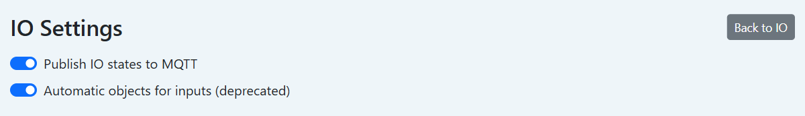

<a id="io"></a>
<a id="io-list"></a>

## Список портов

Откройте **IO** в меню контроллера или перейдите на `/io`. Здесь можно добавить порт и открыть его настройки. В столбце **Port** указана маркировка клеммы на контроллере, например `DIN5` или `OUT3`. В **Name** отображается имя, по которому к порту обращаются в сценариях и через API, например `in5` или `out3_kor_sv`. Нажмите на имя, чтобы открыть карточку.

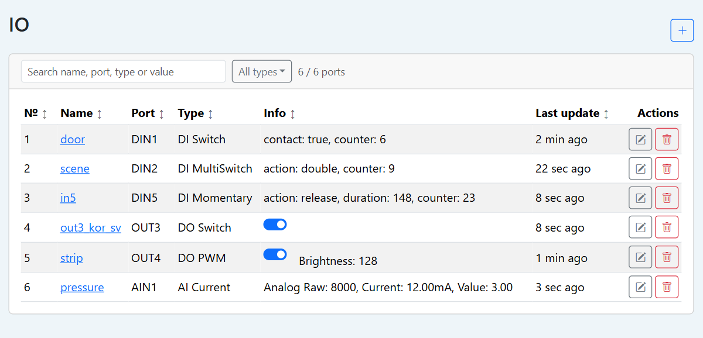

На снимке показан пример с демонстрационными данными. Реле `out3_kor_sv` заблокировано: рядом с именем виден замок, переключатель недоступен. Для шторы `curtain` доступны открывание, остановка и закрывание; у энкодера `knob` показано положение.

Значения и переключатели в таблице обновляются в реальном времени. В столбце **Info** сразу видно, как сработал контакт, какое действие распознала кнопка или как изменилось показание датчика. Дискретный выход можно переключить прямо в строке. Если его переключит сценарий или другой пользователь, новое положение сразу отобразится в открытой таблице.

**Last update** показывает, сколько времени прошло с последнего обновления значения. После синхронизации часов контроллера точное время доступно в подсказке при наведении.

Для поиска введите имя, клемму, тип или отображаемое значение. В **All types** можно выбрать несколько групп. Нажатие на заголовок столбца сортирует строки, повторное нажатие меняет направление. В **Actions** карандаш переименовывает порт, корзина удаляет его после подтверждения. После переименования используйте новое имя в привязках, подписках и командах управления.

<a id="io-add"></a>

## Добавление порта

Нажмите **+** справа над списком и раскройте поле **Type**. Заголовки групп показывают количество свободных совместимых клемм. На снимке свободны три дискретных входа, три аналоговых и два выхода. Эти два выхода можно использовать отдельно в группах **Digital Outputs** и **Analog Outputs** или вместе для одного привода в **Actuators**. После назначения клеммы число свободных мест уменьшается во всех использующих её группах. В **Encoders** показано максимальное количество энкодеров, которое ещё можно добавить с учётом свободных входов и общего лимита энкодеров. AB занимает два входа, ABZ — три. Например, при пяти свободных входах и достаточном лимите отображается **Encoders (2 available)**: можно добавить два AB либо один AB и один ABZ. При нехватке ресурсов соответствующий тип выбрать нельзя.


<a id="io-port-options"></a>

### Выбор клеммы и имени

1. После выбора типа нажмите **Next** справа. В **Port** выберите свободную клемму. Занятые клеммы помечены именами использующих их портов. Для привода выберите два выхода: **Opening output** — открывание, **Closing output** — закрывание.
2. Введите **Name**. По умолчанию контроллер предлагает маркировку в нижнем регистре, например `din6`. Имя должно быть уникальным, длиной до 128 байт, без `/`, `+`, `#`, управляющих символов и пробелов по краям.
3. Нажмите **Add** справа. Порт сразу появится в списке с настройками по умолчанию. Для дискретного входа режим автоматически выбирается по клемме контроллера.
4. Откройте карточку созданного порта и вкладку **Settings**, чтобы изменить тайминги, инверсию, поведение при запуске и другие параметры.

На первом шаге **Cancel** находится слева и закрывает форму. На втором шаге вместо неё показана **Back**, возвращающая к выбору типа. Кнопки **Next** и **Add** расположены справа.

<a id="io-card"></a>

### Карточка порта

Нажмите имя порта в списке. Имя показано в заголовке карточки. Под ним расположены **Port** и **Type** в компактном блоке с переносом на узком экране. **Last update** находится справа от кнопок вкладок; точное время доступно в подсказке. На вкладке **States** находятся команды и текущие значения. **Settings** содержит настройки выбранного типа. Переключатели действуют сразу. Для поля с кнопкой **Apply** введите значение и нажмите эту кнопку.

Наведите указатель на название поля, значение или элемент управления: подсказка показывает имя свойства. Для свойства с доступом на чтение и запись выводится только имя, например `state`. Пометка `(GET)` означает только чтение, `(SET)` — только запись.

<a id="io-actions"></a>

### Actions состояний

На вкладке **States** таблица разделена на **State**, **Value** и **Action**. Основные состояния показаны первыми; только у них можно назначить действие: записать новое значение в объект или запустить Lua-сценарий. Дополнительные показания остаются доступными для просмотра без поля назначения. Например, событие кнопки можно направить в сценарий света, а показание давления — в объект автоматики.

В столбце **Action** показано текущее назначение. Длинный текст сокращается многоточием; полный текст доступен при наведении. Нажмите кнопку с карандашом в нужной строке: откроется окно с текущим Action. Измените его или введите новый и нажмите **Apply**. **Cancel** закрывает окно без изменений.

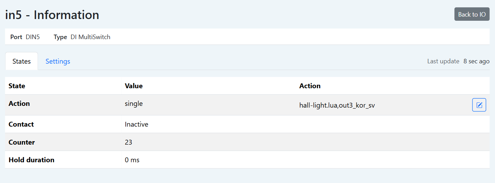

На снимке у первой строки **Action** задано `hall-light.lua,out3_kor_sv`. Обработчик получает событие кнопки. **Contact**, **Counter** и **Hold duration** показывают дополнительные сведения без отдельного Action. Файл `hall-light.lua` должен быть загружен на контроллер; [пример его содержимого](#io-example) приведён в разделе Lua.

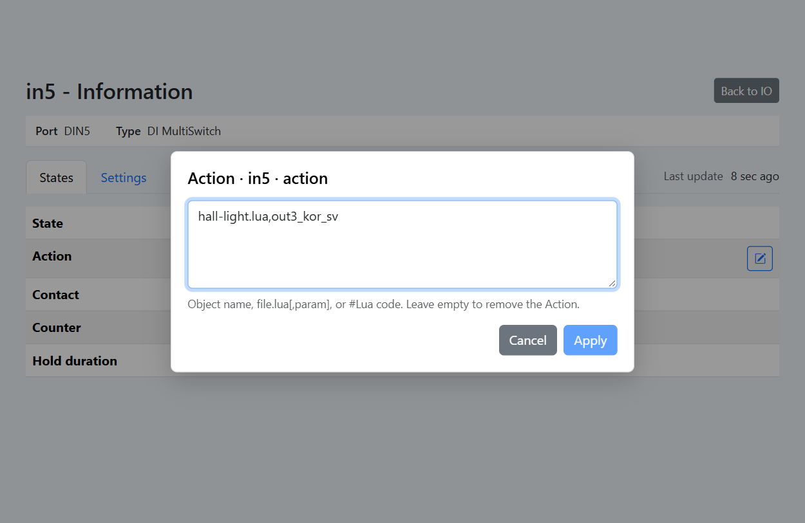

| Что указать | Что произойдёт |
| --- | --- |
| Имя объекта, например `heating.pressure` | Новое значение состояния будет записано в этот объект. |
| Имя файла, например `hall-light.lua` | Будет запущен Lua-сценарий. |
| Имя файла с параметром, например `hall-light.lua,out3_kor_sv` | Сценарий получит строку после запятой в `Event.Param`. |
| `#` и Lua-код, например `#print(Event.IO.Value)` | Будет выполнен указанный код. |
| Пустая строка | Явный Action для этого состояния будет отключён. В окне редактирования очистите поле и нажмите **Apply**. Автоматические объекты продолжают работать, если включена соответствующая галочка в **IO Settings**. |

Все поля **Action** изначально пустые. Для входов и энкодеров при включённой **Automatic objects for inputs (deprecated)** прежние автоматические записи и явный Action выполняются **параллельно**. Например, событие кнопки `in5` обновит `io.in5.value` и одновременно запустит указанный в Action файл. При выключенной галочке выполняется только явный Action. Если в Action указать тот же объект, который автоматически обновляется для этого состояния, контроллер сделает одну запись, чтобы не вызвать обработчик дважды.

Для обычных состояний действие срабатывает при изменении значения. События кнопки, а также `delta` и `action` энкодера обрабатываются при каждом реальном событии, даже если значение совпало с предыдущим. Просмотр карточки, изменение самой привязки, переименование и повторная публикация MQTT не запускают назначенное действие. Изменение настройки само по себе также не является событием; если оно меняет основное показание или состояние выхода, обработчик получает это изменение.

Само переключение **Lock** не запускает Action: у этого параметра нет обработчика состояния. При блокировке, разблокировке и повторном считывании входа учитываются фактические изменения основных значений. Например, Action получит изменившийся `contact` входа **Sensor** после разблокировки или новое отличающееся аналоговое показание. Прежние события `action` кнопки, `delta` и `action` энкодера при этом не воспроизводятся повторно.

Первой строкой у **Multiclick switch** и **Momentary switch** показана **Action** — последнее событие `press`, `single`, `hold` и другие. Это значение поля `action`, а столбец **Action** справа задаёт его обработчик. Для этих типов назначение доступно только у события кнопки. Отключение обработчика не выключает порт и не останавливает обновление его показаний. Саму привязку можно редактировать и при **Lock**.

Назначения сохраняются вместе с конфигурацией IO. Для настройки из сценария используйте [`io.setAction`](#io-set-action).

<a id="io-di-types"></a>

## Digital Inputs — дискретные входы

| Тип в меню | Когда выбрать и что покажет порт |
| --- | --- |
| **Sensor** | Для датчиков протечки, открытия, дыма, движения и других бинарных датчиков с дискретным выходом. **Contact** показывает **Active** или **Inactive**. **Counter** увеличивается при каждом изменении контакта. |
| **Counter** | Для импульсных счётчиков воды, газа и других приборов с импульсным выходом. В карточке видны число импульсов и показание в выбранных единицах. [Как задать цену импульса](#io-counter). |
| **Momentary switch** | Устаревший тип для кнопки без фиксации. Формирует `press` при нажатии и `release` при отпускании. **Hold duration** показывает длительность нажатия. Все эти возможности есть в **Multiclick switch**. |
| **Multiclick switch** | Для кнопок и кнопочных выключателей без фиксации. Различает нажатие, отпускание, серию кликов и удержание, в том числе после одного или нескольких коротких кликов. |
| **Toggle** | Для классического выключателя с фиксацией или тумблера. **Contact** показывает текущее положение контакта. При каждом переходе из активного положения в неактивное **Toggle value** переключается между `0` и `1`. |

<a id="io-multiclick"></a>

### Как срабатывает мультиклик

**Multiclick switch** предназначен для кнопок и кнопочных выключателей без фиксации. Пока кнопка нажата, контакт активен. После отпускания он возвращается в исходное состояние. Первая строка **Action** в карточке показывает последнее распознанное событие.

**Настройки времени.** После добавления входа откройте вкладку **Settings**, введите нужные интервалы и нажмите **Apply** у изменённых полей. Диапазон каждого поля — целые значения от `0` до `65535` мс.

| Поле в форме | По умолчанию | От какого момента идёт отсчёт |
| --- | --- | --- |
| **Debounce (ms)** | 50 мс | Фильтрация физического контакта при нажатии и отпускании. Контроллер опрашивает кнопку с шагом 10 мс. От исходного устойчивого состояния при значении 50 мс требуется пять отсчётов нового уровня. Для `0` достаточно одного отсчёта. |
| **Multiclick delay (ms)** | 300 мс | Пауза от **последнего подтверждённого отпускания**. Если до завершения паузы началось следующее нажатие, оно входит в ту же серию. После его отпускания отсчёт начинается заново. |
| **Hold delay (ms)** | 1000 мс | Порог удержания от **начала текущего подтверждённого нажатия**. Для комбинации «клик, затем удержание» время удержания отсчитывается от второго нажатия. |

Времена на схеме отсчитываются после фильтрации дребезга. Метка `≈` означает событие по таймеру. Контроллер выдаёт его при обработке истёкшего интервала. При нулевом **Multiclick delay** результат может появиться уже при ближайшей обработке после отпускания. Нулевой **Hold delay** позволяет засчитать удержание с начала подтверждённого нажатия.

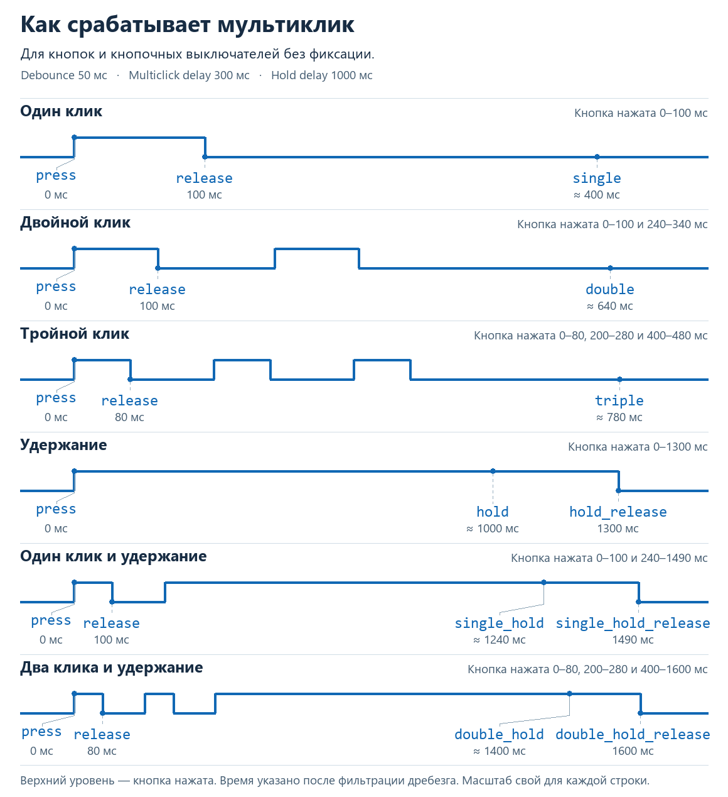

**Начало серии.** Первое подтверждённое нажатие даёт `press`. Если оно короткое, первое отпускание даёт `release`. У следующих коротких нажатий внутри этой серии отдельные `press` и `release` не публикуются. После паузы приходит один результат всей серии.

| Коротких нажатий подряд | Результат серии |
| --- | --- |
| 1 | `single` |
| 2 | `double` |
| 3 | `triple` |
| 4 | `quadruple` |
| От 5 до 255 | `many_N`, где `N` — число нажатий. Например, `many_5` и `many_12`. На предельном 255-м отпускании `many_255` выдаётся сразу. |

**Если последнее нажатие удерживать**, событие начала удержания приходит по достижении **Hold delay**. При отпускании приходит парное событие завершения. Ждать **Multiclick delay** после него не требуется. Короткие нажатия перед удержанием входят в имя комбинации. Отдельного `single` или `double` за них не будет.

| Коротких кликов перед удерживаемым нажатием | При удержании | При отпускании |
| --- | --- | --- |
| 0 — удерживается первое нажатие | `hold` | `hold_release` |
| 1 — удерживается второе | `single_hold` | `single_hold_release` |
| 2 — удерживается третье | `double_hold` | `double_hold_release` |
| 3 — удерживается четвёртое | `triple_hold` | `triple_hold_release` |
| 4 — удерживается пятое | `quadruple_hold` | `quadruple_hold_release` |
| От 5 до 254 | `many_N_hold` | `many_N_hold_release` |

В семействе `many_N_hold` число `N` включает удерживаемое нажатие. Например, пять коротких и удержание шестого дают `many_6_hold` и `many_6_hold_release`. При завершении удержания **Hold duration** показывает полное время от начала последнего нажатия до его отпускания, включая сам порог удержания. **Counter** у мультиклика считает выданные действия — одно короткое нажатие обычно увеличивает его на три (`press`, `release`, `single`).

**Примеры с настройками 50 / 300 / 1000 мс**

- Кнопку нажали в 0 мс и отпустили в 100 мс. События — `press` в 0, `release` в 100, `single` примерно в 400 мс. Если снова нажать после выдачи `single`, начнётся новая серия с `press`.
- К первому клику добавили нажатие с 240 до 340 мс. После первых `press` и `release` приходит `double` примерно в 640 мс. Результат считается от второго отпускания.
- Кнопку держали с 0 до 1300 мс. Последовательность — `press`, примерно в 1000 мс `hold`, в 1300 мс `hold_release`. Длительность — 1300 мс.
- Первый клик закончился в 100 мс, второе нажатие длилось с 240 до 1490 мс. Примерно в 1240 мс появится `single_hold`, в 1490 мс — `single_hold_release`. Длительность удержания — 1250 мс.

При отпускании контроллер сверяет отметки времени. Если порог уже достигнут, а событие удержания ещё не успело выйти, начало и завершение удержания могут прийти подряд. Если удержание уже объявлено, но по отметке отпускания длительность оказалась меньше порога, завершение имеет вид `release`, `single_release`, `double_release`, `triple_release`, `quadruple_release` или `many_N_release` с тем же правилом для `N`. Это уточнение времени при обработке переходов. Обычная серия коротких кликов завершается именем из первой таблицы.

Если свет должен переключаться сразу в начале нажатия, обрабатывайте `press`. Если одному и двум кликам нужны разные действия, используйте `single` и `double`. Привязка одного действия одновременно к `press` и `single` выполнит его дважды при одиночном клике.

При переносе сценария с **Momentary switch** учитывайте, что у старого типа каждое нажатие даёт `press`, а каждое отпускание — `release` и длительность. У **Multiclick switch** `press` отмечает начало серии. Короткое первое нажатие заканчивается `release`, а длительное — `hold_release` с длительностью в миллисекундах. Следующие нажатия внутри серии входят в общее событие.

<a id="io-counter"></a>

### Counter — импульсный счётчик

Выберите **Counter**, если прибор выдаёт один импульс на определённый объём воды или газа. При переходе входа из активного состояния в неактивное **Counter** увеличивается на единицу. **Value** показывает число учтённых импульсов, умноженное на **Multiplier**.

Введите цену одного импульса в **Settings → Multiplier**. Например, для водосчётчика с ценой импульса 10 л задайте `10`. После трёх импульсов в **States** появятся **Counter** = `3` и **Value** = `30` л.

На вкладке **States** можно изменить **Value** вручную. При следующем изменении контакта контроллер снова вычислит **Value** по числу учтённых импульсов и коэффициенту.

<a id="io-encoder"></a>

## Энкодеры AB и ABZ

AB определяет направление и относительное перемещение по двум сдвинутым сигналам. ABZ дополнительно использует метку одного оборота. Подходят и механические поворотные энкодеры; встроенную кнопку энкодера добавляют отдельным входом **Multiclick switch**.

| Механический энкодер AB | Промышленный инкрементальный энкодер |
| --- | --- |
| 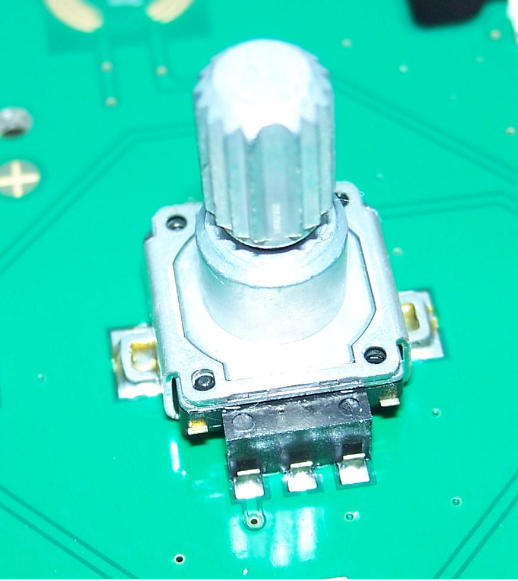 | 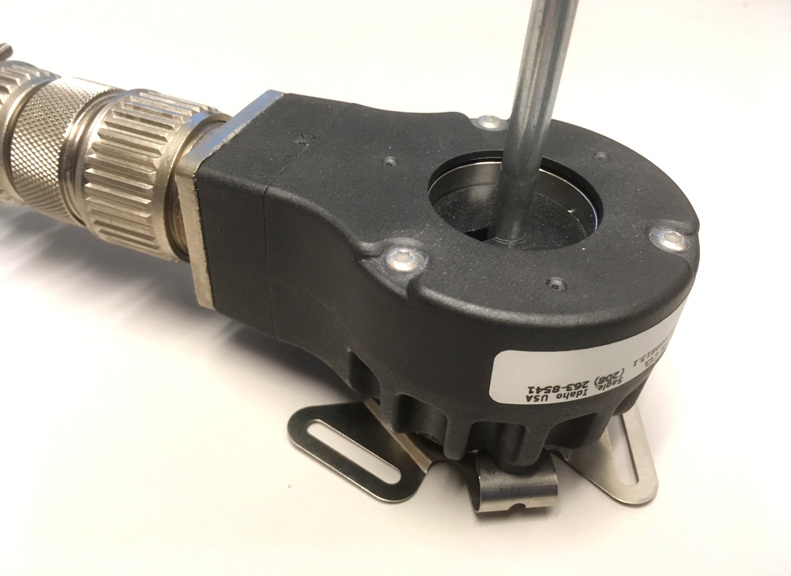 |
| Поворотная ручка для регулирования значения или выбора пункта. Каналы A и B определяют направление и число шагов. | На фото энкодер серии 25T. Для режима ABZ выбирают исполнение с индексным выходом Z; его наличие проверяют по маркировке и паспорту конкретного устройства. |

Фото слева: Cschirp, [Rot enc.JPG](https://commons.wikimedia.org/wiki/File:Rot_enc.JPG), [CC BY-SA 3.0](https://creativecommons.org/licenses/by-sa/3.0/). Фото справа: Lambtron, [RotaryIncrementalEncoder.jpg](https://commons.wikimedia.org/wiki/File:RotaryIncrementalEncoder.jpg), [CC BY-SA 4.0](https://creativecommons.org/licenses/by-sa/4.0/). Фотографии приведены без изменений.

Доступно до **4 энкодеров**, если хватает свободных входов. Мастер учитывает оба ограничения. Входы энкодера нельзя одновременно назначить обычным дискретным входам или перенастроить командами `gpio` из Lua. Удаление энкодера освобождает все его входы.

### Добавление энкодера

Нажмите **+** на странице IO. В группе **Encoders** выберите **Encoder AB** или **Encoder ABZ**, затем нажмите **Next**. Выберите свободные клеммы **Input A**, **Input B**, а для ABZ — ещё **Index input Z**. Для ABZ укажите **Pulses per revolution (PPR)** из паспорта энкодера: это число полных периодов канала A на оборот, до умножения на четыре. Введите имя и нажмите **Add**. В списке появится одно устройство, занимающее все выбранные входы.

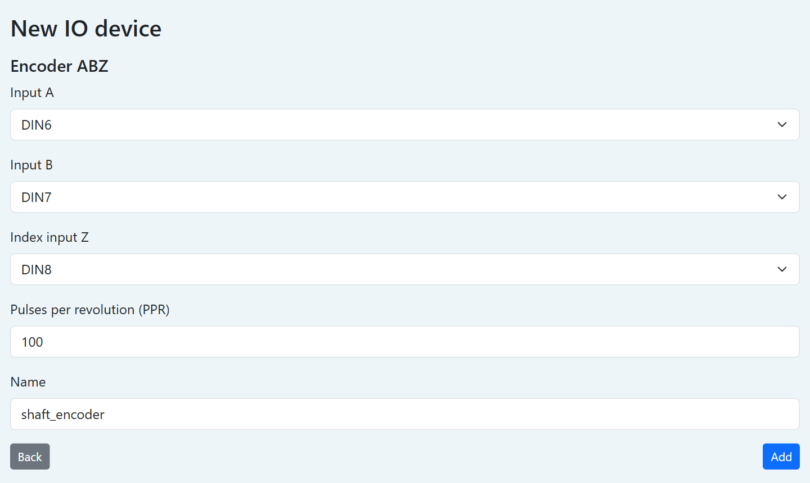

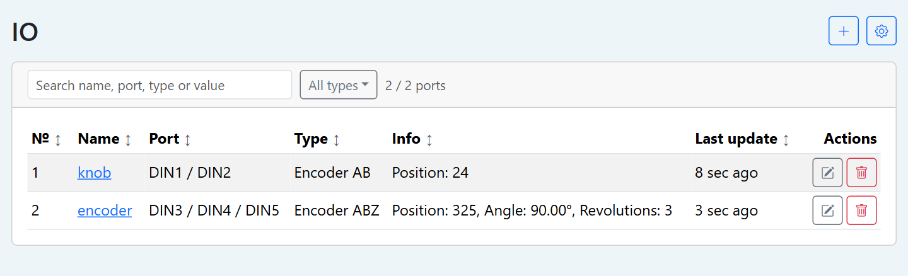

Снимки в этом разделе получены из текущего классического веб-интерфейса с демонстрационными данными.

### Примеры подключения

У механического энкодера контакты A и B подключаются к двум свободным дискретным входам, C — к общему контакту входной цепи. Пример рассчитан на входы для сухих контактов. Напряжение и ток опроса должны укладываться в допустимые значения контактов энкодера. Порядок выводов A/B/C и обозначение общей клеммы сверяйте с маркировкой и паспортами устройств. Кнопка на валу имеет отдельные контакты и не является каналом Z.

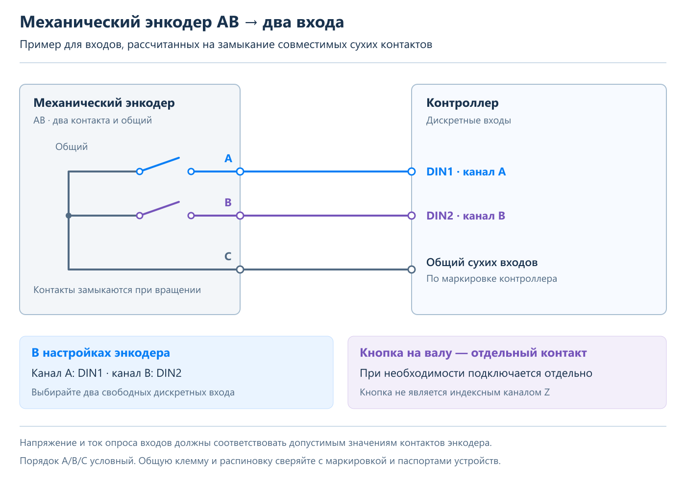

ABZ обозначает состав сигналов, но не их напряжение и не тип выходного каскада. Промышленный энкодер подключают напрямую только при совместимости его выходов с дискретными входами контроллера. На следующей схеме показан вариант через согласователь: его входы выбирают под энкодер, выходы — под контроллер. Для RS-422 нужен приёмник дифференциальных линий A±, B± и Z±. Питание, распиновку и соединение общих проводов определяют паспорта устройств.

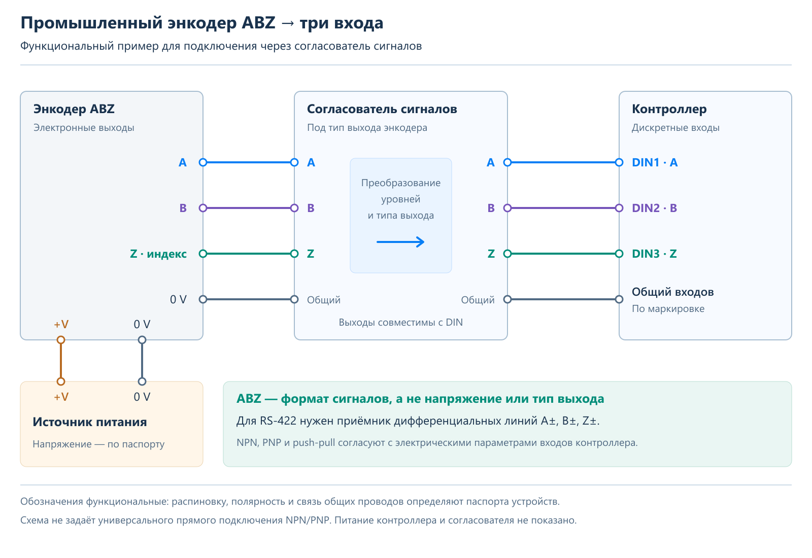

### Настройки и показания энкодера

| Поле | Как работает |
| --- | --- |
| **Position** | Знаковое положение относительно начального значения. Введите `0` и нажмите **Apply** для сброса или задайте любое целое от `−2147483648` до `2147483647`. При выходе за границу счётчик циклически переходит на противоположную границу. |
| **Reverse direction** | Меняет знак последующих перемещений. Накопленное положение сохраняется. По умолчанию выключено. Под переключателем показаны назначенные входы: `A: DIN1 · B: DIN2`, для ABZ — также вход Z. |
| **Transitions per step** | Число переходов A/B на один шаг: `4` — полный цикл, `2` — половина цикла, `1` — каждый переход. По умолчанию `4`. Для механического энкодера выберите значение, соответствующее одному фиксированному щелчку. |
| **Glitch filter (µs)** | Аппаратный фильтр коротких помех, `0…12` мкс; по умолчанию `1` мкс. `0` выключает фильтр. Это не миллисекундная задержка подавления дребезга. |
| **Pulses per revolution (PPR)** | Только ABZ. Число периодов A на оборот, `1…4294967295`. При `PPR=100` получается 400 переходов A/B; с настройкой `4` перехода на шаг — 100 шагов за оборот. Для добавления через API без этого параметра используется `1`. |
| **Index active low** | Только ABZ. Выключено: меткой служит фронт Z `0 → 1`; включено: `1 → 0`. Выбирайте по сигналу на входе контроллера. |
| **Index debounce (µs)** | Только ABZ. Минимальное время между принимаемыми метками Z, `0…4294967295` мкс; по умолчанию `1000` мкс. Для быстрого вращения уменьшите его с учётом периода оборота. |
| **Lock** | Фиксирует показания. Перемещения и метки Z во время блокировки отбрасываются. После снятия блокировки скачка Position нет; ABZ ждёт новую метку для восстановления привязки оборота. Для изменения настроек и Position сначала снимите Lock. |

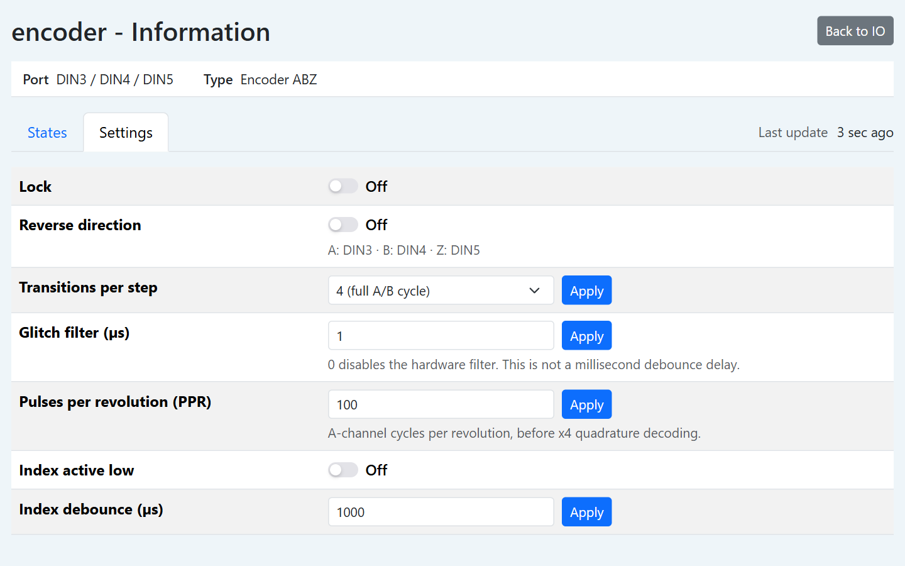

Полный цикл A/B даёт четыре перехода. При настройке **4** короткое движение контакта туда и обратно не создаёт отдельного шага: учитывается суммарное перемещение до следующего полного шага. Повреждённые сигналы и пропущенные фронты программно восстановить нельзя; допустимая частота зависит также от входной схемы конкретного контроллера.

У ABZ до первой метки **Index received** показывает **No**, а **Revolutions**, **Position within revolution** и **Angle** неизвестны. Первая принятая метка задаёт начало оборота. Далее показываются число полных оборотов, положение внутри оборота в шагах и угол `0…360°`. При обратном переходе через начало оборота число оборотов уменьшается, а угол переходит к концу шкалы. Следующие метки уточняют привязку к ближайшему целому обороту; повторные фронты около одной метки не добавляют вымышленных оборотов. Z не сбрасывает независимое относительное поле **Position**.

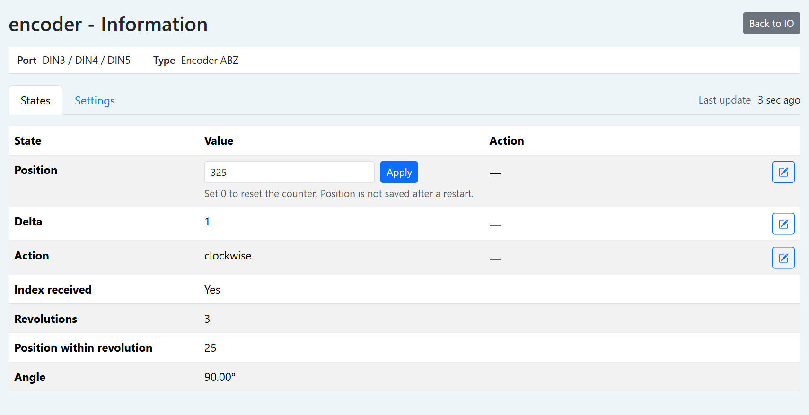

При смене направления, числа переходов на шаг или PPR энкодер ABZ заново ждёт метку Z. После перезапуска **Position** начинается с нуля, привязка Z неизвестна. В `/io.json` сохраняются клеммы и изменённые настройки, но не положение и не события вращения.

Обновления интерфейса и события объединяются с интервалом не менее **50 мс**, аппаратный счёт при этом продолжается. В событии `delta` находится суммарное знаковое число шагов, а `action` — `clockwise` или `counterclockwise`. Для сценария, которому важно число шагов, используйте `delta`, а не количество сообщений. Программная установка Position, переименование и повторная публикация состояния не создают событие вращения.

<a id="io-ai-types"></a>

## Analog Inputs — аналоговые входы

| Тип в меню | Когда выбрать и что покажет порт |
| --- | --- |
| **Raw** | Для чтения отсчётов АЦП, например при калибровке. **Raw ADC value** показывает целое число с учётом поправки **Calibration offset**. |
| **Voltage** | Для измерения напряжения. В карточке **Voltage** выводится в вольтах, например `13.33 V`. |
| **Current** | Для датчиков с токовым выходом, в том числе 4–20 мА. **Current** показывает ток в миллиамперах, **Sensor status** — состояние токовой линии. |
| **Resistance** | Для измерения сопротивления резистивного датчика. **Resistance** выводится в омах. |
| **NTC** | Для термистора с номиналом 10 кОм при 25 °C и коэффициентом B = 3950 К. **Temperature** показывает температуру в °C. |

Выберите тип, соответствующий сигналу датчика и измерительной цепи канала. Для каждого аналогового входа можно задать свой интервал чтения.

<a id="io-analog"></a>

### Аналоговые измерения

На вкладке **States** строка **Raw ADC value** показывает отсчёт АЦП с учётом поправки. Рядом выводится измерение выбранного типа, например **Current** в мА или **Voltage** в В. Включив **Conversion**, можно одновременно видеть исходное измерение и рассчитанную по нему величину.

| Поле | Как пользоваться |
| --- | --- |
| **Read interval (ms)** | Период чтения этого канала, по умолчанию `5000` мс. Изменяется в карточке порта. Отсчёт идёт от последнего измерения. Контроллер опрашивает добавленные и разблокированные каналы. Если отсчёт прежний, время последнего изменения остаётся прежним. |
| **Calibration offset** | Поправка к коду АЦП в отсчётах, от −32768 до 32767, по умолчанию `0`. Отрицательный результат сложения ограничивается нулём. |
| **Calibration scale** | Коэффициент, на который умножается измеренное напряжение перед вычислением тока, напряжения, сопротивления или температуры. По умолчанию `1`. Для типа **Raw** преобразование использует непосредственно отсчёты АЦП. |
| **Conversion status**, **Converted value** | Первое поле показывает состояние пересчёта, второе — его численный результат. Обе строки скрыты при выключенной конвертации. Параметры шкалы задаются на вкладке **Settings**. |

При **Conversion → Disabled** дополнительные настройки пересчёта на вкладке **Settings** скрыты. Выберите **Enabled**, чтобы раскрыть границы шкалы и значения вне диапазона. Сначала настройте их, затем нажмите **Apply** у **Conversion**. Скрытие полей не сбрасывает заданные значения.

<a id="io-pressure"></a>

### Как перевести 4–20 мА в давление 0–6 МПа

Пусть датчик подключён к `AIN1`. По его паспорту **4 мА соответствуют 0 МПа**, а **20 мА — 6 МПа**. Для такой характеристики достаточно задать две точки. Между ними изменение давления пропорционально изменению тока. Шкала начинается с 4 мА, поэтому на середине диапазона, при **12 мА**, давление равно **3 МПа**.

1. На странице **IO** нажмите **+ → Analog Inputs → Current → Next**. Выберите `AIN1`, введите имя `pressure` и нажмите **Add**. Если токовый вход уже создан, сразу откройте его по имени.
2. На вкладке **Settings** выберите **Conversion → Enabled**, чтобы раскрыть дополнительные поля, но пока не нажимайте **Apply** у **Conversion**. Заполните поля из таблицы, подтверждая каждое его кнопкой **Apply**.
3. Нажмите **Apply** у **Conversion**, чтобы включить пересчёт. На вкладке **States** сравните **Current**, **Conversion status** и **Converted value**.

| Поле на вкладке Settings | В примере | Что задаёт |
| --- | --- | --- |
| **Input low** | `4` | Ток на нижней границе, мА. |
| **Output low** | `0` | Давление при 4 мА, в МПа. |
| **Input high** | `20` | Ток на верхней границе, мА. Должен быть больше **Input low**. |
| **Output high** | `6` | Давление при 20 мА, в МПа. |
| **Value below range** | `-1` | Значение, которое вернётся при токе строго ниже 4 мА. |
| **Value above range** | `-2` | Значение, которое вернётся при токе строго выше 20 мА. |

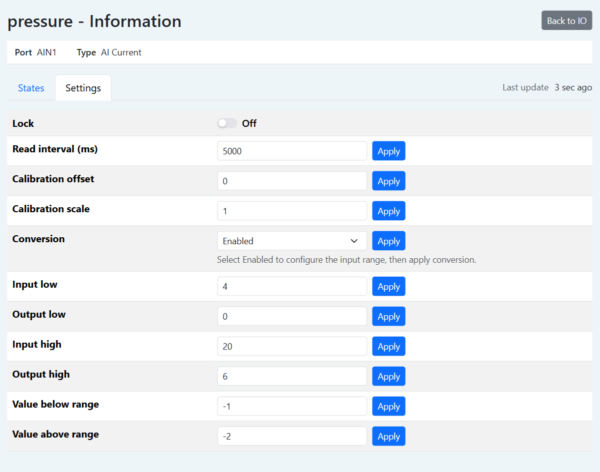

**Расчёт внутри диапазона.** Контроллер определяет, какую долю входной шкалы занимает измерение, и откладывает ту же долю на выходной шкале.

```text
Доля = (измерение − Input low) / (Input high − Input low)
Результат = Output low + Доля × (Output high − Output low)
```

Для нашего датчика каждый дополнительный 1 мА сверх 4 мА соответствует 0,375 МПа. Например, при 8 мА получим `(8 − 4) × 0,375 = 1,5` МПа. На обеих границах пересчёт ещё действует.

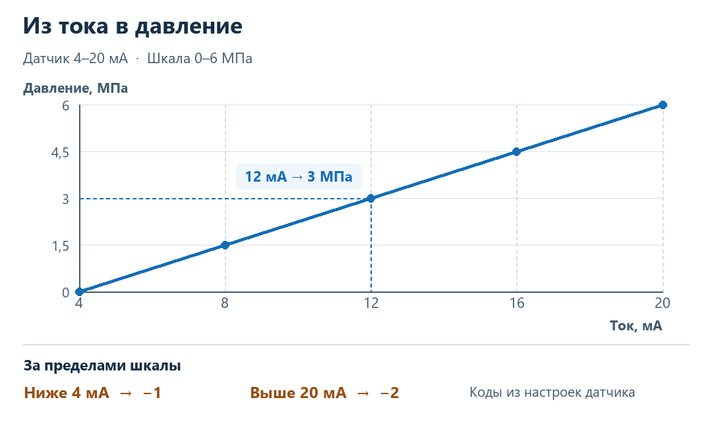

| Ток, мА | Давление, МПа | Conversion status |
| --- | --- | --- |
| 4 | 0,00 | Normal |
| 8 | 1,50 | Normal |
| 12 | 3,00 | Normal |
| 16 | 4,50 | Normal |
| 20 | 6,00 | Normal |

На снимке **Current** равен `12.00 mA`, **Converted value** — `3`. Единицу результата определяет выбранная шкала. В этом примере число в **Converted value** читается в мегапаскалях. Строка **Current** по-прежнему показывает исходный ток.

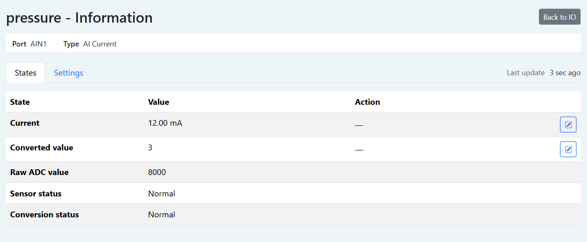

**Как отличить выход за шкалу от неисправности линии.** **Conversion status** сравнивает ток с введёнными границами 4 и 20 мА. **Sensor status** отдельно оценивает саму токовую линию. При токе до 3 мА включительно карточка показывает **Disconnected**, при токе от 25 мА включительно — **Short circuit**. Между этими порогами состояние линии — **Normal**.

| Ток | Sensor status | Conversion status | Что появится в Converted value |
| --- | --- | --- | --- |
| 0 мА | Disconnected | Below range | `-1` |
| 3,5 мА | Normal | Below range | `-1` |
| 21 мА | Normal | Above range | `-2` |
| 25 мА | Short circuit | Above range | `-2` |

Числа `-1` и `-2` выбраны для этого примера как признаки ошибки. В сценарии используйте результат как давление, когда **Conversion status** равен **Normal**. Для датчика с другой шкалой подставьте его паспортные пределы. Например, при шкале 0–60 бар можно задать **Output high** `60` и получать результат в барах.

У самой границы учитывайте округление. При измерении 3,999 мА строка **Current** покажет `4.00 mA`, а **Conversion status** — **Below range**. Контроллер сравнивает с границами полное значение до округления для экрана.

<a id="io-relay-type"></a>
<a id="io-relay"></a>

## Digital Outputs — дискретные выходы

Дискретный выход включает и выключает нагрузку. Его аппаратное исполнение зависит от модели контроллера и установленных в нём модулей. Это может быть электромеханическое реле, бесшумное симисторное реле или транзисторный выход. Для любого из этих исполнений при добавлении выберите **Digital Outputs → Relay Switch**.

На вкладке **States** переключатель **State** показывает логическое состояние выхода и позволяет его изменить. На вкладке **Settings** можно настроить импульс, защитные интервалы и взаимную блокировку выходов.

| Параметр | Как работает |
| --- | --- |
| **Inverted** | Меняет полярность сигнала управления выходом. По умолчанию **No**. |
| **Power-on behavior** | Определяет состояние при запуске. **Off** оставляет выход выключенным, **On** запрашивает включение. **Keep current level** учитывает аппаратный уровень, который контроллер может прочитать при инициализации. После полного снятия питания результат зависит от аппаратной схемы. |
| **Pulse mode**, **Pulse time (ms)** | Задают направление и длительность одиночного импульса. По умолчанию режим **Disabled**, время `1000` мс. |
| **Startup delay (ms)** | Через сколько миллисекунд после запуска контроллера разрешено включить выход. Действует и для **Power-on behavior → On**. |
| **Minimum on time (ms)** | Сколько выход должен оставаться включённым после фактического включения, прежде чем разрешено выключение. |
| **Minimum off time (ms)** | Сколько выход должен оставаться выключенным после фактического выключения, прежде чем разрешено следующее включение. |
| **Interlock** | Выбирает режим взаимной блокировки и номер группы выходов. |

Параметры выхода можно изменить на вкладке **Settings**. При применении **Inverted** управляющий сигнал реле сразу меняет полярность при сохранении логического **State**. Новое значение **Power-on behavior** действует при следующей инициализации выхода.


<a id="io-relay-nc"></a>

### Постоянно включённая нагрузка на нормально замкнутом контакте NC

Например, роутер должен работать постоянно, а контроллеру нужно изредка выключать его для перезагрузки. Для такой схемы подойдёт электромеханическое реле без фиксации, у которого выведены общий контакт **COM** и нормально замкнутый контакт **NC**. Питание роутера пропускают через эту пару. Пока катушка обесточена, цепь **COM–NC** замкнута и роутер получает питание.

В этом примере выход при обычной полярности подаёт питание на катушку по команде **On**. Добавьте **Relay Switch**, откройте его вкладку **Settings** и задайте **Inverted → Yes** и **Power-on behavior → On**. Теперь переключатель **State** соответствует питанию роутера. На вкладке **States** установите **State → On**. Оставьте **Startup delay (ms) → 0**, чтобы при следующем запуске IO сразу применил **On**. При заданной задержке IO может на время ожидания перевести нагрузку в **Off**.

| Ситуация | Катушка реле | Контакт COM–NC | Питание роутера |
| --- | --- | --- | --- |
| IO запустился с **Power-on behavior → On** или получена команда **State → On** | Обесточена | Замкнут | Включено |
| Применена команда **State → Off** | Под напряжением | Разомкнут | Выключено |
| Контроллер обесточен и питание катушки пропало | Обесточена | Замкнут | Включено, если сохранилось питание самого роутера |


Для автоматической перезагрузки задайте **Pulse mode → Pulse OFF** и, например, **Pulse time (ms) → 5000**. Одной команды **Off** достаточно, чтобы отключить роутер на пять секунд. Контроллер сам вернёт **On**, даже если на время перезагрузки связь с веб-интерфейсом пропадёт. При **Pulse mode → Disabled** питание возвращают отдельной командой **On**.

При потере питания контроллера или при отказе, который снимает напряжение с катушки, контакт **COM–NC** замыкается механически. Нагрузка продолжит работу или снова получит питание, если была выключена. Для этого её источник питания должен оставаться доступным. При зависании контроллера выход может удерживать катушку под напряжением. В таком случае **COM–NC** останется разомкнутым до обесточивания катушки.

<a id="io-relay-pulse"></a>

### Импульс на включение или выключение

Если выход должен включаться на полсекунды, установите **Pulse mode → Pulse ON** и **Pulse time (ms) → 500**. Команда **On** включит выход на 500 мс. Затем он вернётся в **Off**. Для выхода, который обычно включён, задайте **Power-on behavior → On** и **Pulse mode → Pulse OFF**. Тогда команда **Off** выключит его на заданное время и выход самостоятельно вернётся в **On**.

Импульс запускает переход в выбранное состояние. Повтор той же команды во время импульса сохраняет исходный срок завершения. Установка начального уровня при запуске сама по себе импульс не запускает. Длительность задаётся целым числом от 1 до 4 294 967 295 мс. Фактическое время переключения контактов механического реле зависит также от его конструкции.

<a id="io-relay-protection"></a>

### Задержка старта и защита от частых переключений

**Startup delay** помогает разнести запуск мощных устройств с большим пусковым током. Например, для трёх выходов с **Power-on behavior → On** задайте задержки `5000`, `15000` и `25000` мс. При обычном запуске, когда IO уже инициализирован к этим моментам, первое устройство сможет включиться через 5 секунд от старта контроллера, второе через 15, третье через 25. Пусковые токи этих устройств приходятся на разное время. Это разовая задержка от старта контроллера. Последующие включения регулирует **Minimum off time**.

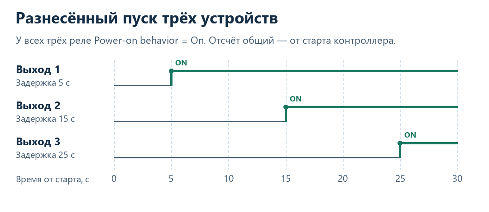

**Minimum off time** и **Minimum on time** помогают защитить насосы и компрессоры от частых включений и выключений. Первое ограничение выдерживает паузу перед повторным пуском после остановки, второе обеспечивает минимальную продолжительность работы после пуска. Интервалы выбирают по требованиям конкретного оборудования. Например, если компрессору нужна пауза **3 минуты** между остановкой и следующим пуском, задайте **Minimum off time (ms) → 180000**.

У всех трёх интервалов `0` отключает ограничение, рабочий диапазон — от 1 до 4 294 967 295 мс. Если команда поступила раньше срока, выход остаётся в прежнем состоянии. Под переключателем появится время ожидания, например **Off in 3 s**. Повтор той же команды сохраняет срок, а команда возврата к текущему уровню отменяет ожидающий переход. В режиме **Pulse ON** или **Pulse OFF** из трёх ограничений действует только **Startup delay**. Оба минимальных времени снова действуют после возврата в **Disabled**.


<a id="io-interlock"></a>

### Взаимная блокировка дискретных выходов

На вкладке **Settings** выберите режим **Interlock**, введите номер группы от `1` до `65535` и нажмите **Apply**. Для всех участников одной группы нужен одинаковый режим.

| Режим | Что произойдёт |
| --- | --- |
| **Disabled** | Выход работает самостоятельно. Номер группы `0` используется для выхода из группы. |
| **Only one relay on** | Перед включением выбранного выхода контроллер выключает остальные включённые выходы группы. Например, при включении `channel_b` сначала выключится `channel_a`. |
| **Only one relay off** | Перед выключением выбранного выхода контроллер включает остальные выключенные выходы группы. |

Если защитный интервал другого выхода ещё действует, запрос ждёт разрешённого момента. Если необходимое переключение другого выхода запрещено его **Lock**, контроллер отклоняет команду.

<a id="io-pwm-type"></a>
<a id="io-pwm"></a>

## Analog Outputs — ШИМ-выход PWM Dimmer

Выберите **PWM Dimmer**, чтобы регулировать среднюю мощность нагрузки, например светодиодной ленты. Выходной каскад и нагрузка должны поддерживать ШИМ. **Частота** задаёт, сколько раз в секунду повторяется импульс, **заполнение** — какую долю периода выход активен. На вкладке **States** переключатель **State** включает и выключает нагрузку. Ползунок **Brightness** регулирует яркость света. Чтобы задать заполнение напрямую, введите **Raw PWM duty**.

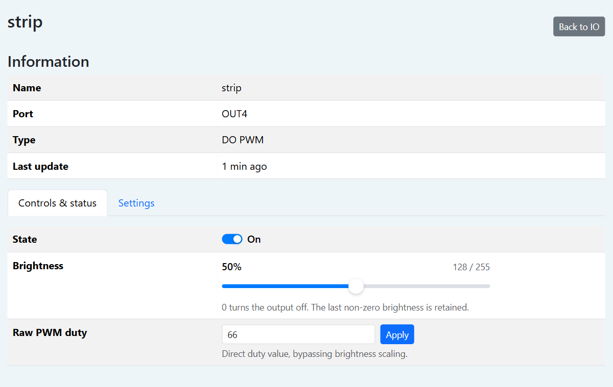

| States | Что можно сделать |
| --- | --- |
| **State** | Включить или выключить выход. При выключении заполнение становится нулевым. При следующем включении восстанавливается последняя ненулевая яркость в пределах текущего сеанса работы. После запуска первое включение использует верхнюю границу сохранённой шкалы яркости. |
| **Brightness** | Ползунок от `0` до **Brightness scale** (по умолчанию `255`). Ноль выключает выход. Ненулевое значение включает его и преобразуется в заполнение по экспоненциальной кривой с учётом **PWM minimum** и **PWM maximum**. |
| **Raw PWM duty** | Целое число от `0` до **PWM physical maximum**. Значение записывается напрямую, в обход шкалы яркости и настроенных пределов яркости. Ноль выключает выход. Прямая запись меняет состояние и заполнение, прежняя пользовательская яркость сохраняется. |

| Settings | По умолчанию | Диапазон и действие |
| --- | --- | --- |
| **Lock** | Off | Фиксирует выход на текущем уровне. Подробности — в [разделе о блокировке](#io-lock). |
| **Inverted** | No | Общий параметр формы выходов. Драйвер **PWM Dimmer** использует обычную полярность. |
| **Power-on behavior** | Off | Общий параметр формы выходов. Драйвер **PWM Dimmer** при запуске устанавливает нулевое заполнение. |
| **PWM frequency (Hz)** | 3000 Гц | Целое число от 100 до 15000 Гц. При изменении частоты драйвер перезапускает ШИМ, выключает выход и сбрасывает **PWM minimum** и **PWM maximum**. |
| **PWM resolution (bits)** | 12 бит | От 8 до 12 бит. Определяет число ступеней заполнения. Изменение разрешения также выключает выход и сбрасывает оба предела. |
| **PWM physical maximum** | 4096 при 12 битах | Верхняя граница прямого заполнения, только для чтения. Вычисляется как 2 в степени разрешения. При 8, 9, 10, 11 и 12 битах это соответственно 256, 512, 1024, 2048 и 4096. |
| **PWM minimum** | 1 | Минимальное заполнение для ненулевой яркости. Допускается от `1` до **PWM maximum**. Например, предел можно поднять до уровня, при котором светодиодная лента начинает светиться. Изменение выключает выход. |
| **PWM maximum** | Физический максимум | Максимальное заполнение для команды яркости. Допускается от **PWM minimum** до **PWM physical maximum**. Ограничивает верхний уровень. Изменение выключает выход. |
| **Brightness scale** | 255 | Верхняя граница пользовательской яркости, целое число от 2 до 65535. Например, значение `100` даёт ползунок `0…100`. Изменение выключает выход. |
| **Brightness step (%)** | 10 % | Размер шага команд `STEP_UP` и `STEP_DOWN`, от 1 до 255 % пользовательской шкалы. Шаг округляется, минимум — одна единица. При шкале 255 шаг 10 % составляет 26 единиц. Из выключенного состояния первый шаг вверх устанавливает яркость `1`. |

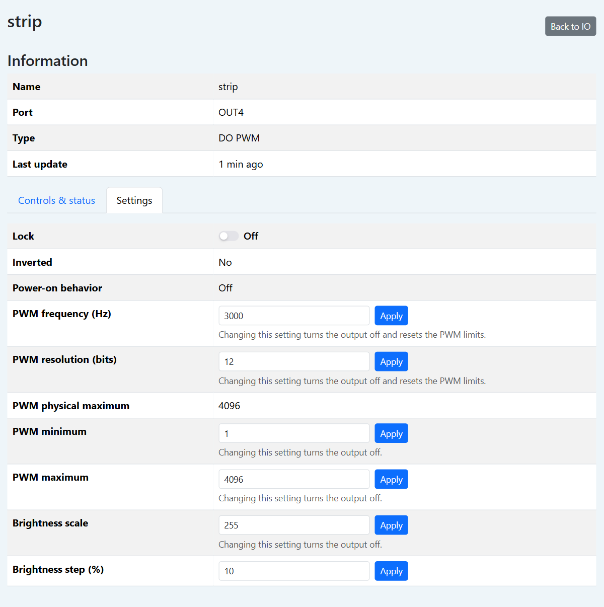

Частоту и разрешение задаёт один аппаратный таймер. Доступность конкретной пары зависит от контроллера. Для более высокой частоты может потребоваться меньшее разрешение.

**Пример для 12 бит.** При **Raw PWM duty** `1024`, `2048` и `3072` выход активен соответственно 25, 50 и 75 % периода. При частоте 3000 Гц период равен примерно 333 мкс. При заводских настройках ползунка **Brightness → 128** даёт **Raw PWM duty → 66**, то есть около 1,6 % периода. Для ровно 50 % задайте **Raw PWM duty → 2048**.


<a id="io-actuator"></a>

## Приводы с двумя выходами

В группе **Actuators** доступны **Curtain / roller shutter**, **Venetian blind with slats** и **Valve / damper**. Один порт IO занимает две свободные выходные клеммы контроллера. В заголовке группы показано количество доступных пар. Уже добавленные одиночные выходы сначала освободите.

При добавлении выберите **Opening output** — выход открывания, **Closing output** — выход закрывания, затем имя. Для шторы `100%` означает полностью открытое положение, `0%` — закрытое. Привод должен иметь трёхпозиционное управление: один выход задаёт движение в одном направлении, второй — в другом, оба выключены — остановку. Приводы с аналоговым управлением 0–10 В или изменением полярности двигателя требуют другого способа подключения.

В списке и на вкладке **States** есть кнопки движения и **Stop**. В карточке кнопки **Open**, **Stop**, **Close** расположены в строке **State** перед текущим статусом; у жалюзи рядом доступны **Slat +** и **Slat −**. Карточка показывает положение, фазу движения, включённые выходы и ошибку. Строка **Position** объединяет текущее положение, слайдер для его изменения и **Action**. Во время перетаскивания слайдер показывает выбираемое значение; после отпускания отправляется команда движения. Принятая цель отображается ниже в **Requested position**. Для клапана с выключенным **Intermediate positioning** строка **Position** показывает только положение и **Action**. Значения обновляются через общее соединение IO в реальном времени.

Для состояний привода используются только явные **Actions**, независимо от галочки **Automatic objects for inputs (deprecated)**. Старые автоматически созданные объекты остаются в каталоге, но больше не обновляются без явного назначения. Чтобы сохранить нужный объект, укажите его имя в Action соответствующей строки: например, `io.curtain.position` для **Position**.

Оба выхода никогда не включаются одновременно. При реверсе контроллер отключает текущее направление и выдерживает **Reversal pause**, в том числе после отдельной команды **Stop**. Окончание каждого участка хода ограничивается `esp_timer`, без отдельной задачи привода. **Lock** немедленно останавливает привод и отменяет дальнейшее движение. **Stop** доступен и при блокировке. Обычные настройки одиночного реле — импульсы, `power_on_behavior` и interlock — к паре не применяются.

После запуска оба выхода выключены. Текущее положение не записывается во flash и сначала обозначается как **Unknown**. Выполните полный ход к одному из краёв, чтобы установить отсчёт. Положение вычисляется по времени хода и отмечается как **Estimated**. До установления отсчёта доступны команды полного открытия, закрытия и остановки.

| Настройка | Значение по умолчанию | Назначение |
| --- | --- | --- |
| **Reverse direction** | Off (`false`) | Меняет местами выходы для движения к `100%` и `0%`, включая поворот ламелей. Остановка отключает оба выхода. |
| **Full opening time**, **Full closing time** | 20000 мс каждое | Время полного хода в каждом направлении. Для жалюзи задаётся без отдельного поворота ламелей. Настройте по реальному приводу. |
| **Reversal pause** | 500 мс | Минимальное время между отключением одного направления и включением противоположного. |
| **Endpoint overrun** | 0 мс | Дополнительное время питания после расчётного достижения края. Ноль отключает продление. Используйте только с приводом, имеющим встроенное отключение на концах хода. |

Времена задаются целыми миллисекундами до `4294967295`, минимальное значение — `1`, для продления — `0`. Настройки времени изменяются у остановленного привода.

Настройки пары сохраняются в `/io.json` через обычный таймер автосохранения. Прямые команды Lua `gpio.mode`, `gpio.write` и PWM не могут управлять занятыми приводом выходами.

**Reverse direction** (`invert_direction`) — переключатель **On/Off**, доступный только на остановленном приводе. При **On** для открытия используется второй назначенный выход, для закрытия — первый. Под переключателем показано фактическое назначение с учётом инверсии, например `Open: OUT2 · Close: OUT1`. Значение `100%` по-прежнему означает открытое положение, `0%` — закрытое. Времена открытия и закрытия остаются привязаны к этим логическим направлениям. Смена инверсии сбрасывает расчётное положение и наклон ламелей. Для восстановления отсчёта выполните полный ход к краю. Пауза реверса сохраняется и при смене инверсии.

<a id="io-actuator-wiring"></a>

### Пример подключения трёхпозиционного привода

В примере используются привод **24 В DC** с общим проводом и двумя входами направления, а также два выхода контроллера с **сухими релейными контактами COM–NO**. На вход направления подаётся питание на время движения. Если оба входа обесточены, привод останавливается. Такой вариант трёхпозиционного управления предусмотрен, например, у [Belimo LR24A — схема «AC/DC 24 V, 3-point»](https://www.belimo.com/mam/general-documents/datasheets/en-gb/belimo_LR24A_datasheet_en-gb.pdf). Обозначения входов на рисунке условные: номера проводов и фактические направления берите из паспорта своего привода.

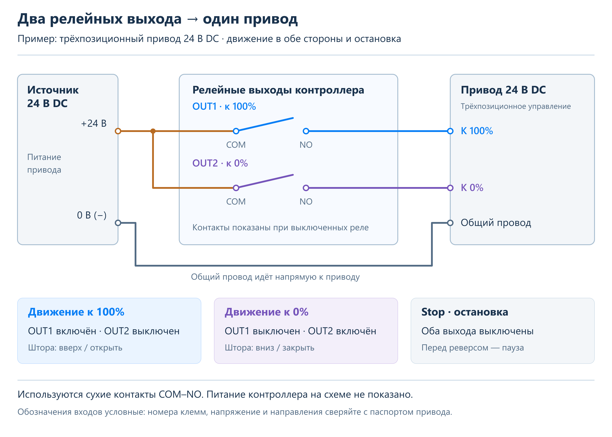

1. Подключите **+24 В** источника питания привода к **COM** обоих релейных выходов.
2. Соедините **NO выхода OUT1** со входом движения к `100%`, **NO выхода OUT2** — со входом движения к `0%`.
3. Соедините **0 В** источника непосредственно с общим проводом привода. Контакты **NC** в этом примере не используются.
4. При добавлении порта выберите `OUT1` в **Opening output**, `OUT2` в **Closing output**. Эти два выхода принадлежат одному порту IO и не добавляются как отдельные **Relay Switch**.
5. После добавления откройте **Settings**, задайте время полного хода по паспорту привода и проверьте направления. Для шторы движение к `100%` должно открывать её, к `0%` — закрывать. Затем выполните полный ход к краю для установки отсчёта положения.

На схеме **Reverse direction = Off**. Если направления оказались перепутаны, остановите привод и включите **Reverse direction**, чтобы поменять назначение выходов без перестановки проводов.

Питание контроллера на рисунке не показано. Эта схема относится именно к сухим релейным контактам и приводу на **24 В DC**. Для симисторных и транзисторных выходов, приводов на другом напряжении и двигателей с реверсом полярности требуется соответствующая схема подключения.

<a id="io-actuator-blind"></a>

### Жалюзи с ламелями

Тип **Venetian blind with slats** предназначен для механизма, в котором тот же двигатель сначала поворачивает ламели, а затем перемещает полотно. Контроллер учитывает эти участки отдельно. Слайдер **Position** управляет полотном, **Slat tilt** — ламелями. **Slat +** и **Slat −** изменяют наклон на один шаг, а во время движения останавливают привод.

| Настройка | По умолчанию | Назначение |
| --- | --- | --- |
| **Full slat travel** | 1200 мс | Время поворота ламелей от одного края до другого. |
| **Slat travel** | 180° | Геометрия механизма, 90° или 180°. В шкале 180° значение `50%` соответствует горизонтальному положению. |
| **Slat steps** | 6 | Количество равных шагов по полной шкале, от 1 до 100. |
| **Restore slat tilt** | Yes | После изменения высоты восстановить прежний наклон, если он известен. |

Наклон задаётся от `0` до `100%`. При полном подъёме управление ламелями недоступно. Сначала опустите полотно. Если во время перемещения задать новый наклон, он будет применён после достижения заданного положения. Команда **Stop** отменяет и движение, и последующее восстановление наклона.

<a id="io-actuator-valve"></a>

### Смесительный клапан и заслонка

Для трёхпозиционного смесительного клапана выберите **Valve / damper** и включите **Intermediate positioning**. Значения `0%` и `100%` означают противоположные края хода привода. Назначьте выходы так, чтобы эти положения соответствовали нужным направлениям изменения потоков A и B на конкретном клапане. Значение `50%` означает половину хода, а не гарантированное смешивание пополам.

Контроллер управляет движением и положением. Автоматического регулирования по датчику температуры в этом режиме нет. При выключенном **Intermediate positioning** доступны только крайние положения и остановка. У трёхходового клапана крайнее положение не обязательно перекрывает общий поток, поэтому кнопки в карточке обозначены **100%** и **0%**.

Для клапана с приводом 24 В DC подходит [пример подключения выше](#io-actuator-wiring). Создайте порт `mixer`, выберите **Valve / damper**, назначьте `OUT1` и `OUT2` и включите **Intermediate positioning**. Если полный ход занимает 90 секунд в каждом направлении, задайте **Full opening time = 90000 ms** и **Full closing time = 90000 ms**. После полного хода к `0%` команда положения `40%` переместит привод примерно на 40% хода. Какому пути — **A → AB** или **B → AB** — соответствует каждый край, зависит от клапана, установки привода и выбранных направлений. Эти проценты не задают температуру и не гарантируют такую же долю расхода.

<a id="io-lock"></a>

## Блокировка порта

**Lock** временно блокирует порт. Для выхода блокировка запрещает запуск и любые новые команды, адресованные этому выходу IO из сценариев, API и интерфейсов контроллера, в том числе из Lua, веб-интерфейса и MQTT. Например, при работающем контроллере выключенный насос останется выключенным и при срабатывании расписания, и при нажатии кнопки в интерфейсе. Уже включённый дискретный выход сохранит текущее состояние.

Для блокировки откройте карточку порта и включите **Settings → Lock**. В карточке появится пометка **Locked**.

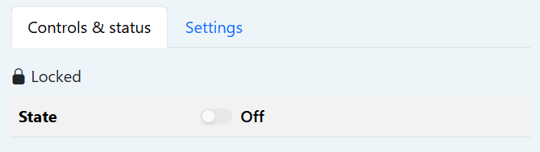

| Порт | Пока включён Lock | После снятия блокировки |
| --- | --- | --- |
| Дискретный вход | Фиксируются текущее значение, последнее действие кнопки и счётчик. Серия кликов прерывается. | Контроллер считывает фактический уровень контакта. Нажатия и импульсы за время блокировки пропускаются. Следующее нажатие начинает новую серию. |
| Аналоговый вход | Сохраняются последнее измерение и результат преобразования. | Чтение возобновляется с текущего сигнала. |
| Дискретный выход | Новые команды управления блокируются. Отложенный защитной паузой переход отменяется. Уже начатый импульс завершается в положенное время с возвратом в исходное состояние. | Доступны новые команды. Для отменённого перехода потребуется новая команда. |
| PWM Dimmer | Текущее заполнение сохраняется. Блокируются управление состоянием, яркостью и прямым заполнением, а также настройки, изменение которых само переключает выход. | Снова доступны переключатель, ползунок и прямое задание заполнения. |

Чтобы вернуть управление, выключите **Settings → Lock**. Состояние самой блокировки входит в конфигурацию порта. Если оно было сохранено, порт останется заблокированным и после перезапуска IO.

**При старте контроллера** дискретный выход принимает состояние, заданное в **Power-on behavior**, даже при сохранённой блокировке. Если выбрано **On**, выход может включиться при старте с учётом **Startup delay**. Для насоса, который при подаче питания должен оставаться выключенным, оставьте **Power-on behavior → Off** на вкладке **Settings**.

<a id="io-save"></a>

## Сохранение и загрузка конфигурации

При запуске сервиса IO контроллер читает `/io.json` и восстанавливает имена, типы и настройки портов с привязкой к клеммам. В разделе `ports` есть запись на каждый настроенный порт. Внутри записи сохраняются только отличия от значений по умолчанию. Например, при стандартном имени `din1` и стандартных настройках входа достаточно записи `"DIN1": {}`.

Когда вы явно задаёте **Publish IO states to MQTT** через веб или API, IO сохраняет выбранное значение в том же файле, в поле `cfg.mqtt`. Даже явно выбранное `false` имеет приоритет над аргументом запуска из Lua. В старом файле поле может отсутствовать. Галочка автозапуска из **Services** хранится в общей конфигурации контроллера.

Настройка **Automatic objects for inputs (deprecated)** сохраняется как `cfg.auto_objects`. Значение по умолчанию `true` в файл не записывается, для отключения сохраняется `false`. Если поля нет, автоматические объекты входов и энкодеров включены — это сохраняет работу их старой конфигурации. На приводы эта настройка не влияет.

Явные привязки **Action** также входят в `/io.json`; по умолчанию они пустые. Пустая строка отключает только явный Action и не влияет на автоматические объекты. Установка через веб, HTTP и `io.setAction()` в Lua использует один и тот же механизм сохранения.

Если в старой конфигурации сохранён Action дополнительного показания, которое больше не поддерживает назначение, такая привязка при загрузке игнорируется. Сам порт и его остальные настройки восстанавливаются. Прежние автоматические объекты входов и энкодеров по включённой галочке продолжают работать независимо от ограничений явных Actions.

Добавление, переименование, удаление порта или изменение настройки вступает в силу сразу. Запись в файл происходит **через 60 секунд после последнего изменения конфигурации**. Каждая следующая правка начинает отсчёт заново. Файл записывается только при наличии отличий от сохранённой версии. Если за время ожидания вернуть все настройки к сохранённым значениям, запись пропускается. Текущие измерения, счётчики импульсов, состояния дискретных выходов и текущая яркость ШИМ в конфигурацию не входят.

Оранжевая дискета справа вверху страницы означает, что есть несохранённые изменения. Наведите на неё указатель, чтобы увидеть оставшееся время. После успешной записи значок исчезает. При ошибке записи в подсказке появится время до повторной попытки. Перед перезапуском дождитесь сохранения, если хотите восстановить последние изменения.

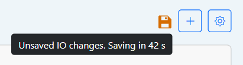

<a id="io-legacy-config"></a>
<a id="io-addgpioinput"></a>
<a id="io-addgpiooutput"></a>
<a id="io-addextanaloginput"></a>

### Совместимость с устаревшими командами добавления портов в Lua

**Добавление портов через Lua устарело и не рекомендуется.** Для новых устройств откройте страницу **IO**, нажмите **+** и выберите тип и клемму. Команды `io.addGPIOInput`, `io.addGPIOOutput`, `io.addExtAnalogInput` и `io.addExtOutput` сохранены для совместимости с существующими сценариями.

При первом запуске без сохранённых портов старый сценарий создаст их, и IO автоматически запишет конфигурацию. При следующих запусках IO сначала восстанавливает `/io.json`. Когда сценарий повторяет объявление, IO находит существующий порт по аппаратной клемме.

| Что записано в старом сценарии | Что произойдёт при его выполнении |
| --- | --- |
| Объявлена свободная клемма | IO создаст порт. Поэтому порт, удалённый через веб, может снова появиться, пока его объявление активно. |
| Та же клемма и те же настройки | Существующий порт сохраняет своё состояние. Совпадение параметров само по себе не запускает запись файла. |
| Та же клемма и явно заданное другое значение | Сценарий изменит соответствующую настройку, если порт допускает изменение. Например, явно указанные `100` мс подавления дребезга заменят сохранённые `50` мс. Изменение включится в обычное автосохранение. |
| У порта того же типа необязательный параметр опущен | IO использует сохранённое значение этого параметра. Например, если в объявлении реле указан только выход и его имя, настроенная через веб длительность импульса сохранится. |
| Порт переименован в веб-интерфейсе, а в старом объявлении осталось его исходное имя | По той же клемме IO узнает порт и сохранит выбранное в веб-интерфейсе имя. В подписках и обработчиках используйте актуальное имя. |

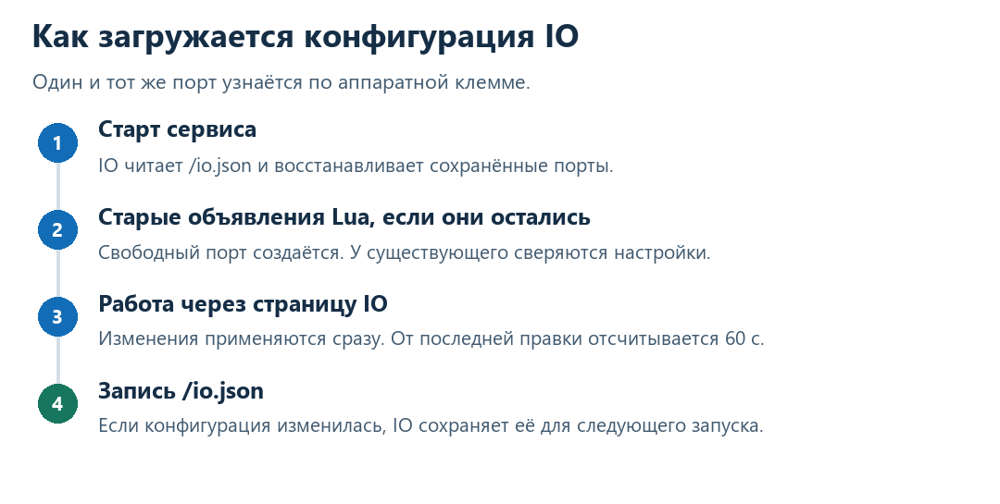

<a id="io-migration"></a>

### Как перейти на полное управление портами через IO

1. Один раз запустите контроллер с действующим старым сценарием. Откройте **IO** и сверьте **Port**, **Name**, тип и важные настройки с прежней конфигурацией. Убедитесь, что все нужные порты появились, и дождитесь исчезновения оранжевой дискеты.
2. Включите **IO** в **Settings → Services** и нажмите **Save**. В `init.lua` и вызываемых им файлах закомментируйте строки **добавления портов**. Если при старте сценарий отдельно задаёт постоянные параметры, например калибровку, коэффициент счётчика или параметры импульса, сверьте их с карточками и закомментируйте эти строки тоже. Иначе при запуске они снова запишут свои значения.
3. Если публикацию раньше включал `io.begin(true)`, откройте шестерёнку на странице **IO**, включите **Publish IO states to MQTT** и дождитесь исчезновения оранжевой дискеты. Закомментируйте вызов `io.begin(...)`. Оставьте `require "io"`, обработчики событий и команды автоматики, например переключение света по кнопке.
4. Перезагрузите контроллер. Проверьте, что порты восстановились, обработчики работают и нужные состояния публикуются в MQTT. Дальше добавляйте и настраивайте порты через веб.

**Переход от автоматических объектов к Actions.** Если старые сценарии используют автоматические объекты входов и энкодеров через `obj.get("io.…")` или `obj.setScript("io.…", …)`, оставьте **Automatic objects for inputs (deprecated)** включённой. Переносите обработчики по одному: назначьте Action нужного состояния, в прямом сценарии читайте `Event.IO.Value` вместо `Event.Obj.Value` и отключите прежний обработчик объекта для этой же автоматики. Пока галочка включена, автоматический объект продолжает обновляться параллельно. Когда автоматические объекты больше не нужны ни одному сценарию, снимите галочку и дождитесь сохранения. Сами объекты останутся в каталоге с последними значениями; необходимые записи в именованные объекты можно сохранить явными Actions. Для прежних объектов [приводов](#io-actuator) явное назначение Action требуется независимо от галочки.

<a id="io-lua"></a>

## Lua — объекты и сценарии

<a id="io-begin"></a>

### Устаревший запуск через io.begin

**Запуск IO через `io.begin()` устарел и не рекомендуется.** Включите сервис в **Settings → Services**. Для чтения, управления и обработки событий в Lua по-прежнему используйте `require "io"`, `io.get`, `io.set` и обработчики объектов. При автозапуске IO уже готов к моменту выполнения `init.lua`.

Старые вызовы `io.begin(true)` и `io.begin(false)` по-прежнему работают. Пока в `/io.json` отсутствует `cfg.mqtt`, первый вызов с явным аргументом после загрузки включает или выключает публикацию на текущий сеанс. Это действует и после автозапуска. Сам аргумент в файл не записывается. Без явного аргумента и сохранённой настройки публикация выключена. После выбора в **IO Settings** действует настройка модуля.

### Объекты и события

При включённой **Automatic objects for inputs (deprecated)** сервис сохраняет прежние автоматические привязки входов и энкодеров к объектам вида `io.<имя>.<свойство>`. Например, кнопка `in5` записывает действие в `io.in5.value`, а завершённую длительность в миллисекундах — в `io.in5.duration`. У входа `pressure` доступны измеренный ток `io.pressure.current` и преобразованное давление `io.pressure.value`. Явный **Action** выполняется параллельно с этими записями. Существующие сценарии через `obj.setScript` продолжают работать, пока включены автоматические объекты входов и энкодеров либо нужный объект указан в явном Action.

<a id="io-set-action"></a>

### Привязки io.setAction

`io.setAction(name, state, action)` задаёт назначение для одного состояния порта. `name` — имя IO, `state` — имя поля из таблицы ниже, `action` — строка назначения в том же формате, что в [веб-интерфейсе](#io-actions). Успешный вызов возвращает `true`, ошибка — `nil, error`. Изменение применяется сразу и сохраняется в `/io.json` через 60 секунд после последнего изменения конфигурации, в том числе если выполнено из Lua. Запись того же назначения заново не создаёт изменения.

```lua
require "io"

local ok, err = io.setAction("in5", "action", "hall-light.lua,out3_kor_sv")
io.setAction("pressure", "value", "heating.pressure")
```

**Поддерживаемые основные состояния.** Используйте имена из этой таблицы: они также передаются в `Event.IO.State` и служат ключами `actions` в HTTP API. Ограничение одинаково для веб-интерфейса, HTTP и `io.setAction` в Lua.

| Тип IO | Поля для Action |
| --- | --- |
| **Sensor** | `contact` |
| **Counter** | `value` |
| **Momentary switch**, **Multiclick switch** | `action` |
| **Toggle** | `value` |
| **Analog Inputs** | Исходное измерение по типу входа: `value_raw` для **Raw**, `voltage` для **Voltage**, `current` для **Current**, `resistance` для **Resistance** или `temperature` для **NTC**. Дополнительно у всех типов доступно `value` — **Converted value**. |
| **Relay Switch** | `state` |
| **PWM Dimmer** | `state`, `brightness` |
| **Encoder AB** | `position`, `delta`, `action` |
| **Encoder ABZ** | `position`, `delta`, `action` |
| **Curtain / roller shutter**, **Valve / damper** | `state`, `position` |
| **Venetian blind** | `state`, `position`, `tilt` |

У аналоговых входов привязка **Converted value** (`value`) сохраняется и доступна через `io.setAction` и HTTP даже при `conv_enable=false`. На вкладке **States** при выключенной конвертации скрыты **Converted value** и **Conversion status**, включая поле привязки. После включения конвертации строки появляются снова с сохранённой привязкой. Диагностические и дополнительные показания — например, `error`, `conv_status`, `pwm_raw`, цели движения, качество положения, `motion` и угол энкодера — не поддерживают явные Actions. Это не меняет работу прежних автоматических объектов входов и энкодеров при включённой галочке.

`state` в аргументах `io.setAction` означает имя обрабатываемого поля. Например, у реле само поле называется `state`, у кнопки — `action`. Это отдельная настройка обработчика, а не команда `io.set(name, "state", ...)` для управления выходом. Все Actions по умолчанию пустые. Отдельный механизм автоматических объектов при включённой галочке записывает кнопочный `action` в `io.<имя>.value`, а `value_raw` аналогового типа **Raw** — в `io.<имя>.raw`. Если явный Action совпадает с автоматическим объектом этого же состояния, выполняется одна запись.

При прямом запуске файла или кода через Action сценарий получает событие:

| Поле | Значение |
| --- | --- |
| `Event.Type` | `12` — событие IO. |
| `Event.IO.Name` | Имя порта IO. |
| `Event.IO.State` | Имя изменившегося состояния из таблицы выше. |
| `Event.IO.Value` | Значение, относящееся к этому событию: число, строка, логическое значение либо `nil` для неизвестного состояния. |
| `Event.IO.OldValue` | Предыдущее опубликованное значение, либо `nil`, если оно ещё не было известно. У `delta` и `action` энкодера — значение предыдущего события вращения. |
| `Event.Param` | Параметр после запятой в назначении файла, если он задан. |

Значения сохраняют свой тип: `state` дискретного или ШИМ-выхода — строка `"ON"` / `"OFF"`, `contact` и `value` входа **Toggle** — логическое значение, измерения и счётчики — числа. У неизвестного положения привода или несинхронизированного энкодера значение может быть `nil`.

Берите значение события из `Event.IO.Value`: к моменту выполнения сценария `io.get` уже может вернуть более новое состояние. Для повторных событий кнопки или энкодера новое и предыдущее значения могут совпадать. Назначение объекта использует обычный механизм объектов: его обработчик через `obj.setScript` получает `Event.Obj.Value` и `Event.Obj.OldValue`, а не `Event.IO`. Чтобы такой обработчик запускался и при повторной записи того же значения, передайте `true` третьим аргументом `obj.setScript`.

Если нужен обработчик прямо в строке, начните её с `#`:

```lua
io.setAction("in5", "action", '#if Event.IO.Value == "press" then io.set("out3_kor_sv", "state", "TOGGLE") end')
```

<a id="io-get"></a>
<a id="io-set"></a>
<a id="io-lua-properties"></a>

### Справочник свойств io.get и io.set

`io.get(name, property)` читает свойство, `io.set(name, property, value)` задаёт новое значение. Указывайте имя порта из столбца **Name**. Имена порта и свойства распознаются без учёта регистра. Если сервис ещё не запущен, порт или свойство не найдены, `io.get` возвращает `nil`. В таблицах прочерк в колонке **io.set** означает, что для этого типа порта свойство доступно только на чтение.

Успешный `io.set` завершается без возвращаемых значений. Для конфликта режимов interlock или блокировки другого выхода возможен ответ `nil, "interlock_conflict"` или `nil, "interlock_locked"`. Отсутствие результата само по себе не подтверждает выполнение команды. Проверить значение можно через `io.get`. При защитной задержке состояние выхода изменится после окончания ожидания.

| Задача | Пример вызова |
| --- | --- |
| Прочитать контакт или последнее действие кнопки | `io.get("in5", "contact")` или `io.get("in5", "action")` |
| Прочитать состояние реле | `io.get("out3_kor_sv", "state")` |
| Проверить шкалу и прочитать давление | `io.get("pressure", "conv_status")` и `io.get("pressure", "value")` |
| Заблокировать или разблокировать вход | `io.set("in5", "lock", true)` или `io.set("in5", "lock", false)` |
| Изменить яркость на один шаг | `io.set("strip", "brightness", "STEP_UP")` |
| Задать прямое заполнение 50 % при 12 битах | `io.set("strip", "pwm_raw", 2048)` |

#### Общие свойства

| Свойство | io.get | io.set |
| --- | --- | --- |
| `lock` | Для любого порта. Логическое `true`, если порт заблокирован, иначе `false`. | `true` или `false`. Также принимаются `1`, `0` и строки `"on"`, `"off"`, `"true"`, `"false"`, `"1"`, `"0"`. |
| `invert` | Для выходов. Логическое значение инверсии. | `true` или `false`. Для смены полярности снимите блокировку порта. |
| `power_on_behavior` | Для выходов. Строка `"OFF"`, `"ON"` или `"PREVIOUS"`. | Один из этих режимов либо соответственно `0`, `1`, `2`. Драйвер ШИМ сохраняет обе настройки выхода, но запускается с нулевым заполнением и использует обычную полярность. |
| `state` | Для **Relay Switch** и **PWM Dimmer**. Строка `"ON"` или `"OFF"` показывает применённое состояние. | Строка `"ON"`, `"OFF"` или `"TOGGLE"`. Для подключения через NC смысл команд показан в [примере с роутером](#io-relay-nc). |

При включённой блокировке свойства доступны для чтения. На выходах блокируются команды управления, на входе **Counter** — запись `value`, на аналоговом входе — переключение `conv_enable`. Коэффициент счётчика, параметры калибровки и границы преобразования можно менять и при блокировке. Подробнее о поведении при разблокировке см. в [описании Lock](#io-lock).

#### Дискретные входы

| Свойство | io.get | io.set |
| --- | --- | --- |
| `contact` | Логическое состояние контакта у любого дискретного входа. `true` означает активный контакт. | — |
| `pin_mode` | Режим входа, число. | `gpio.INPUT` (1), `gpio.INPUT_PULLUP` (5) или `gpio.INPUT_PULLDOWN` (9). Для изменения снимите блокировку. При смене подтяжки вход заново считывает уровень и сохраняет накопленный счётчик. |
| `debounce_ms` | Интервал подавления дребезга, мс. | Целое от `0` до `65535`. |
| `send_delay_ms` | Для **Multiclick switch**. Время ожидания следующего нажатия, мс. | Целое от `0` до `65535`. |
| `hold_delay_ms` | Для **Multiclick switch**. Порог удержания, мс. | Целое от `0` до `65535`. |
| `action` | У **Momentary switch** и **Multiclick switch** — строка последнего действия. У **Toggle** — строка `"0"` или `"1"`. До первого события возможно `nil`. **Sensor** и **Counter** действий не формируют. | — |
| `value` | Только **Counter**. Число с учётом коэффициента `multiplier`. | Число. Следующий переход входа пересчитает показание из числа импульсов и коэффициента. |
| `multiplier` | Только **Counter**. Числовой коэффициент пересчёта импульсов, по умолчанию `1`. | Число, например `0.5` литра на импульс. |

При включённых автоматических объектах число импульсов доступно через `obj.get("io.water.counter")` для порта `water`, а длительность завершённого нажатия или удержания кнопки `in5` — через `obj.get("io.in5.duration")` в миллисекундах. Эти дополнительные показания не поддерживают явные Actions. Для событий кнопки используйте `io.get("in5", "action")`.

#### Энкодеры

Общие `io.get(name, property)` и `io.set(name, property, value)` работают с именем энкодера, созданного через веб.

| Свойство | io.get | io.set |
| --- | --- | --- |
| `position` | Относительное положение, знаковое 32-битное целое. | Целое от `−2147483648` до `2147483647`. `0` сбрасывает положение; событие вращения не создаётся. |
| `steps_per_detent` | Переходов A/B на шаг. | `1`, `2` или `4`; по умолчанию `4`. |
| `filter_us` | Аппаратный фильтр, мкс. | `0…12`; по умолчанию `1`. |
| `invert_direction` | Инверсия направления. | `true` / `false`. |
| `pulses_per_revolution` | ABZ: число периодов A на оборот. | `1…4294967295`. |
| `index_active_low` | ABZ: метка по спаду Z. | `true` / `false`; по умолчанию `false`. |
| `index_debounce_us` | ABZ: пауза между принимаемыми метками Z, мкс. | `0…4294967295`; по умолчанию `1000`. |
| `lock` | Заблокирован ли энкодер. | `true` / `false`. |
| `a_port`, `b_port`, `z_port` | Имена клемм; `z_port` только у ABZ. | — |
| `index_seen` | ABZ: получена ли метка Z. | — |
| `revolutions` | ABZ: число полных оборотов от опорной метки. До синхронизации `nil`. | — |
| `position_in_turn` | ABZ: положение внутри оборота в шагах. До синхронизации `nil`. | — |
| `angle` | ABZ: угол в градусах. До синхронизации `nil`. | — |
| `delta` | Число шагов в последнем опубликованном изменении; после программной установки положения или настроек — `0`. | — |
| `action` | `clockwise`, `counterclockwise` или пустая строка при отсутствии движения. | — |

```lua
local position = io.get("encoder", "position")
io.set("encoder", "position", 0)
io.set("encoder", "invert_direction", true)
io.set("encoder", "steps_per_detent", 4)
```

При включённой **Automatic objects for inputs (deprecated)** объекты `io.<имя>.position`, `io.<имя>.delta` и `io.<имя>.action` обновляются при вращении. У ABZ также доступны `index_seen`, `revolutions`, `position_in_turn` и `angle`. До метки последние три значения неизвестны. При блокировке показания фиксируются; после разблокировки требуется новая метка Z.

Для обработки каждого опубликованного перемещения привяжите сценарий к `delta` с запуском **при каждой записи**, иначе два последовательных события с одинаковым числом шагов будут восприняты как неизменившееся значение:

```lua
obj.setScript("io.encoder.delta", "encoder.lua", true)
```

В `encoder.lua` берите число шагов из `Event.Obj.Value`. Оно относится именно к событию в очереди; `io.get("encoder", "delta")` к моменту запуска сценария уже может содержать более новое перемещение. Альтернативный прямой обработчик: `io.setAction("encoder", "delta", "encoder.lua")`; для него используйте `Event.IO.Value`. Такой Action работает независимо от автоматической записи в `io.encoder.delta`. При переходе на прямой обработчик отключите прежний обработчик объекта для той же автоматики.

#### Дискретные выходы

У дискретного выхода типа **Relay Switch** также доступны общие свойства `state` и `lock`.

| Свойство | io.get | io.set |
| --- | --- | --- |
| `pulse_mode` | Строка `"DISABLED"`, `"ON"` или `"OFF"`. | Один из этих режимов. `"ON"` задаёт импульс включения, `"OFF"` — выключения. |
| `pulse_time` | Длительность импульса в мс, по умолчанию `1000`. | Целое от `1` до `4294967295` мс. |
| `min_on_time` | Минимальное время работы от фактического включения, мс. | Целое от `0` до `4294967295` мс. Ноль отключает ограничение. |
| `min_off_time` | Минимальная пауза от фактического выключения до следующего пуска, мс. | Целое от `0` до `4294967295` мс. Ноль отключает ограничение. |
| `startup_delay` | Задержка первого разрешённого включения от старта контроллера, мс. | Целое от `0` до `4294967295` мс. Действует также при импульсном режиме. |
| `interlock_mode` | Строка `"disabled"`, `"on"` или `"off"`. | Один из этих режимов. У всех выходов одной группы режим должен совпадать. |
| `interlock_group` | Номер группы, целое число. | От `1` до `65535` — номер группы, `0` — выход из группы. |

При записи `interlock_mode` и `interlock_group` меняются по отдельности. Чтобы перевести выход в группу с другим режимом, сначала задайте `interlock_group` равным `0`, затем установите новый режим и номер целевой группы.

#### Приводы

Команды движения передаются через `state`, положение — через `position`, наклон — через `tilt`. Общей команды `target` нет.

```lua
io.set("curtain", "state", "UP")      -- также OPEN
io.set("curtain", "state", "DOWN")    -- также CLOSE
io.set("curtain", "state", "STOP")
io.set("blind", "position", 60)        -- после установления отсчёта
io.set("blind", "tilt", 35)            -- можно задать следом за положением
io.set("mixer", "position", 40)        -- Intermediate positioning включено
```

| Свойство | `io.get` | `io.set` |
| --- | --- | --- |
| `state` | `open`, `closed`, `opening`, `closing`, `stopped`. | `OPEN`, `CLOSE`, `STOP`. Для штор и жалюзи также `UP`, `DOWN`. Для жалюзи `STEP_UP`, `STEP_DOWN`. |
| `position` | 0–100 или `nil`, если положение неизвестно. | Целое 0–100. Промежуточное значение требует установленного отсчёта, а у клапана — `intermediate=true`. |
| `tilt` | 0–100 или `nil`. Только жалюзи. | Целое 0–100. |
| `lock` | Булево значение. | `true` останавливает привод и блокирует движение, `false` снимает блокировку без возобновления. |
| `invert_direction` | Булево значение, по умолчанию `false`. | `true` меняет местами выходы направлений, `false` восстанавливает исходное назначение. Только на остановленном приводе. |
| `open_time`, `close_time`, `reverse_delay` | Время в мс. | Целое 1–4294967295. |
| `end_overrun` | Время в мс. | Целое 0–4294967295. |
| `tilt_time`, `tilt_steps`, `tilt_geometry` | Настройки ламелей. | Время 1–4294967295 мс, шаги 1–100, геометрия 90 или 180. |
| `restore_tilt` | Булево значение. Только жалюзи. | `true` / `false`. |
| `intermediate` | Булево значение. Только клапан. | `true` / `false`. |
| `open_port`, `close_port` | Исходные назначения двух клемм. При `invert_direction=true` движение к `100%` использует `close_port`, к `0%` — `open_port`. | Только чтение. |
| `position_target`, `tilt_target` | Текущая цель или `nil`. | Только чтение. |
| `position_quality` | `unknown`, `estimated`. | Только чтение. |
| `motion` | `stopped`, `opening`, `closing`, `reversing`, `tilting`, `overrun`, `fault`. | Только чтение. |
| `open_output`, `close_output` | Включён ли выход движения к `100%` / `0%` с учётом инверсии. | Только чтение. |
| `fault` | Пустая строка либо `hardware_error`, `interrupted`. | Только чтение. |

После прерывания движения обновлением или перезапуском контроллера выполните новый полный ход для установления положения. Изменение длительности полного хода сбрасывает расчётное положение.

Пример смены направления: `io.set("curtain", "invert_direction", true)`. Чтение настройки: `io.get("curtain", "invert_direction")`. Через MQTT отправьте `true` или `false` в `<prefix>/io/curtain/set/invert_direction`, через HTTP — `POST /api/io?id=curtain&name=invert_direction&value=true`.

#### ШИМ-выходы

У **PWM Dimmer** также доступны `state` и `lock`. Примеры того, как соотносятся яркость и заполнение, приведены в [описании карточки PWM](#io-pwm).

| Свойство | io.get | io.set |
| --- | --- | --- |
| `brightness` | Число в пользовательской шкале. При выключенном выходе хранится последняя ненулевая яркость. | Целое от `0` до `brightness_scale` или строка `"STEP_UP"` / `"STEP_DOWN"`. Ноль выключает выход. |
| `brightness_scale` | Верхняя граница шкалы яркости, по умолчанию `255`. | Целое от `2` до `65535`. |
| `brightness_step` | Шаг изменения яркости в процентах шкалы, по умолчанию `10`. | Целое от `1` до `255`. Применяется к командам шага. |
| `pwm_freq` | Частота ШИМ, Гц. | Целое от `100` до `15000` Гц с учётом выбранного разрешения. |
| `pwm_res` | Разрешение ШИМ в битах. | Целое от `8` до `12`. |
| `pwm_phys_max` | Физический максимум заполнения для выбранного разрешения. Например, `4096` при 12 битах. В HTTP это поле называется `pwm_physical_max`. | — |
| `pwm_min` | Нижний предел заполнения для ненулевой яркости. | Целое от `1` до `pwm_max`. |
| `pwm_max` | Верхний предел заполнения для команды яркости. | Целое от `pwm_min` до `pwm_phys_max`. |
| `pwm_raw` | Прямое заполнение в единицах драйвера. | Целое от `0` до `pwm_phys_max`. Например, при 12 битах `2048` соответствует заполнению 50 %. |

#### Аналоговые входы

| Свойство | io.get | io.set |
| --- | --- | --- |
| `value_raw` | Целый отсчёт АЦП с учётом калибровочной поправки. | — |
| `read_interval_ms` | Интервал чтения канала, мс. | Целое от `0` до `4294967294`. Например, `1000` задаёт период в одну секунду. |
| `current` | Измеренный ток в мА для **Current**. | — |
| `voltage` | Измеренное напряжение в В для **Voltage**. | — |
| `error` | Строка состояния токовой линии **Current**. Возможны `"normal"`, `"down"` и `"short"`. | — |
| `cal_raw` | Поправка в отсчётах АЦП, по умолчанию `0`. | Целое от `-32768` до `32767`. |
| `cal_scale` | Коэффициент калибровки напряжения, по умолчанию `1`. | Число. |
| `conv_enable` | Логическое `true`, если включено преобразование в физическую величину. | **Строка** `"true"` или `"false"`. Сначала задайте обе границы входной шкалы. |
| `conv_low_from` | Нижняя граница измеренного сигнала (**Input low**). | Число, меньшее `conv_high_from` для рабочей шкалы. |
| `conv_high_from` | Верхняя граница измеренного сигнала (**Input high**). | Число, большее `conv_low_from` для рабочей шкалы. |
| `conv_low_to` | Значение физической величины на нижней границе (**Output low**). | Число в выбранных единицах. |
| `conv_high_to` | Значение физической величины на верхней границе (**Output high**). | Число в тех же единицах. |
| `conv_err_low` | Результат для сигнала ниже шкалы (**Value below range**). | Число. |
| `conv_err_high` | Результат для сигнала выше шкалы (**Value above range**). | Число. |
| `conv_status` | Строка `"normal"`, `"low"` или `"high"`, характеризующая последнее преобразование. | — |
| `value` | Результат преобразования. Например, у `pressure` — давление в МПа. | — |

У аналоговых входов имена `current` и `voltage` читают одно поле. Его единицу определяет тип порта. Вызов `io.get("pressure", "voltage")` для датчика **Current** вернёт то же число в мА, что и `io.get("pressure", "current")`. Для **Resistance** и **NTC** физическую величину удобно читать через объекты `io.<имя>.resistance` и `io.<имя>.temperature` с помощью `obj.get`, если включены автоматические объекты либо эти назначения заданы явно в Actions.

Используйте `value` и `conv_status` при `conv_enable == true`. Пока преобразование выключено, эти два свойства могут содержать прежнее или начальное значение. Дробные значения аналогового входа `io.get` возвращает с округлением до двух знаков после запятой, а `value` и `multiplier` дискретного счётчика — до трёх.

<a id="io-example"></a>

### Пример — кнопка переключает свет

На странице **IO** добавьте вход `DIN5` типа **Multiclick switch** с именем `in5` и выход `OUT3` типа **Relay Switch** с именем `out3_kor_sv`. В карточке `in5` откройте **States** и в первой строке **Action** задайте назначение `hall-light.lua,out3_kor_sv`. То же назначение из Lua:

```lua
io.setAction("in5", "action", "hall-light.lua,out3_kor_sv")
```

Сохраните обработчик в файле `hall-light.lua`. Проверка `Event.IO.Value` переключает свет сразу по первому нажатию серии. Последующие события той же серии оставляют свет в выбранном состоянии.

```lua
require "io"

if Event.IO.Value == "press" then
    io.set(Event.Param, "state", "TOGGLE")
end
```

**Совместимый вариант через объект.** При включённой **Automatic objects for inputs (deprecated)** оставьте явный Action события пустым и сохраните существующую привязку:

```lua
obj.setScript("io.in5.value", "hall-light.lua", true)
```

В этом варианте обработчик получает событие объекта и читает `Event.Obj.Value`:

```lua
require "io"

if Event.Obj.Value == "press" then
    io.set("out3_kor_sv", "state", "TOGGLE")
end
```

<a id="gpio"></a>

### Прямой доступ к свободным выводам

Для собственных схем доступны низкоуровневые вызовы `gpio`. Используйте их для свободных выводов. Команды именованным портам отправляйте через `io.set`, чтобы сервис учитывал их состояние, блокировку и защитные интервалы.

| Вызов | Назначение |
| --- | --- |
| <a id="gpio-mode"></a>`gpio.mode(pin, mode)` | Установить `gpio.INPUT`, `gpio.INPUT_PULLUP`, `gpio.INPUT_PULLDOWN` или `gpio.OUTPUT`. |
| <a id="gpio-read"></a>`gpio.read(pin)`, `gpio.read(pin, true)` | Прочитать цифровой уровень или код встроенного АЦП на совместимом выводе. |
| <a id="gpio-write"></a>`gpio.write(pin, value)` | Установить `gpio.HIGH`, `gpio.LOW` или выполнить `gpio.TOGGLE`. |
| <a id="pwm-шим"></a><a id="gpio-pwmsetup"></a>`gpio.pwmSetup(pin[, freq[, resolution]])` | Задать частоту и разрешение ШИМ. У этого низкоуровневого вызова исходные значения — 5000 Гц и 8 бит. |
| <a id="gpio-pwm"></a>`gpio.pwm(pin, duty)` | Установить заполнение в единицах выбранного разрешения. |
| `gpio.pwmFade(pin, start, target, time)` | Плавно изменить заполнение за указанное время в миллисекундах. |

Подробнее о сценариях и прямой работе с выводами. [Руководство по Lua](https://slsys.io/lua) · [Примеры работы с GPIO](https://slsys.io/gpio_sample).

<a id="io-mqtt"></a>

## MQTT

Включите **Publish IO states to MQTT** на странице **IO Settings**. Переключатель влияет на исходящие сообщения. При работающем подключении к брокеру IO принимает команды управления и при выключенной публикации. Веб-интерфейс, HTTP API и сценарии работают независимо от MQTT.

**Automatic objects for inputs (deprecated)** управляет только прежними записями входов и энкодеров в объекты контроллера. Снятие этой галочки не отключает MQTT и явно назначенные Actions.

При включённой публикации IO отправляет состояние порта в `<prefix>/io/<имя>`. Вместо `<prefix>` подставьте префикс своего контроллера. Сообщение содержит объект JSON. Для дискретного выхода поле `state` принимает `"ON"` или `"OFF"`. Кнопка публикует действие в `action`, а при завершённом удержании — также `duration` в миллисекундах. У токового входа `current` показывает мА, при включённом пересчёте `value` содержит рассчитанную величину, а `conv_status` — `"normal"`, `"low"` или `"high"`.

| Что сделать | Топик | Данные |
| --- | --- | --- |
| Прочитать давление из примера | Подписаться на `<prefix>/io/pressure` | При 12 мА в сообщении будут `"current":12`, `"value":3` и `"conv_status":"normal"`. |
| Включить реле | `<prefix>/io/out3_kor_sv/set/state` | `ON` |
| Переключить реле | `<prefix>/io/out3_kor_sv/set` | `{"state":"TOGGLE"}` |
| Задать яркость | `<prefix>/io/strip/set/brightness` | `128` |

<a id="io-ha-discovery"></a>

### MQTT HA Discovery — автоматическое обнаружение в Home Assistant

Для приводов используются те же топики IO. Например, отправьте `UP` в `<prefix>/io/curtain/set/state`, `60` в `<prefix>/io/blind/set/position`, `35` в `<prefix>/io/blind/set/tilt`. Топик `<prefix>/io/<name>` содержит JSON с `state`, `motion`, `position`, `position_quality`, состояниями выходов и `fault`. Неизвестное положение передаётся как `null`. Настройки также доступны через `/set/<property>`.

Шторы и жалюзи обнаруживаются как [MQTT Cover](https://www.home-assistant.io/integrations/cover.mqtt/), жалюзи дополнительно передают наклон ламелей. Клапан обнаруживается как [MQTT Valve](https://www.home-assistant.io/integrations/valve.mqtt/). При включённом **Intermediate positioning** доступно задание положения клапана. Discovery не добавляет температурный регулятор.

С помощью **HA MQTT Discovery** Home Assistant автоматически добавляет порты IO как сущности MQTT. В каталоге **Devices** контроллера каждый порт показан отдельной строкой. В Home Assistant эти сущности собраны в одном устройстве контроллера.

1. Подключите контроллер и интеграцию **MQTT** в Home Assistant к одному брокеру. В контроллере включите общий сервис **MQTT**, затем **Publish IO states to MQTT** в настройках IO.
2. На контроллере откройте **Devices → Settings** (шестерёнка). Проверьте **HA Discovery topic prefix**. По умолчанию это `homeassistant`. В настройках интеграции MQTT в Home Assistant должен быть включён Discovery с тем же префиксом. Если хотите публиковать весь каталог **Devices**, включите **HA MQTT Discovery**. Сохраните настройки кнопкой **Save**.
3. Чтобы опубликовать только отдельные порты, оставьте общий переключатель выключенным и включите значок Home Assistant в столбце **Discovery** у нужных строк. В **Edit** порта или отдельной сущности доступны **On**, **Off** и **Inherit**. При наследовании сущность берёт настройку порта, а порт — общую настройку.
4. В Home Assistant откройте **Настройки → Устройства и службы → MQTT**, затем устройство контроллера. В нём появятся сущности выбранных портов.

| Тип порта IO | Что появится в Home Assistant |
| --- | --- |
| **Sensor** | Двоичный датчик (`binary_sensor`). Поле `contact` показывает активное или неактивное состояние контакта. |
| **Counter** | Две сущности. Двоичный датчик показывает контакт, а числовой датчик (`sensor`) — показание `value` с учётом **Multiplier**. |
| **Multiclick switch**, **Momentary switch** | Текстовый датчик (`sensor`) с последним действием из поля `action`, например `press` или `double`. При повторной публикации конфигурации контроллер не воспроизводит прошлое нажатие. |
| **Toggle** | Двоичный датчик по полю `value` со значением `0` или `1`. |
| **Raw**, **Voltage**, **Current**, **Resistance**, **NTC** | Числовой датчик с отсчётом АЦП, напряжением (В), током (мА), сопротивлением (Ом) или температурой (°C). |
| **Relay Switch** | Переключатель (`switch`) для включения и выключения дискретного выхода. |
| **PWM Dimmer** | Светильник (`light`) с включением, выключением и регулировкой яркости по шкале порта. |
| **Encoder AB / ABZ** | Числовой датчик (`sensor`) Position. У ABZ дополнительно датчик Angle в градусах, неизвестный до метки Z. |

Например, у входа `pressure` из [примера с датчиком давления](#io-pressure) автоматически появится датчик тока в мА. Чтобы видеть и давление, включите **Conversion** в карточке входа и добавьте в Home Assistant отдельный MQTT-сенсор. Укажите топик `<prefix>/io/pressure` и единицу `МПа`. Шаблон ниже берёт поле `value` только при нормальном статусе пересчёта, чтобы код выхода за диапазон не попал в историю как измеренное давление. [Настройка MQTT-сенсора в Home Assistant](https://www.home-assistant.io/integrations/sensor.mqtt/).

```jinja
{{ value_json.value if value_json.get('conv_status') == 'normal' else none }}
```

**Как проверить публикацию.** Пусть MQTT-префикс контроллера — `house`, а реле называется `out3_kor_sv`. Подпишитесь на `homeassistant/switch/house/house_out3_kor_sv_switch/config`. Брокер хранит описание сущности с флагом `retain`. В нём указаны топик состояния `house/io/out3_kor_sv`, топик команд `house/io/out3_kor_sv/set/state` и топик доступности контроллера `house/bridge/state`. Если переключатель появился, но его состояние не обновляется, проверьте сообщения в топике состояния. [Настройки MQTT Discovery в Home Assistant](https://www.home-assistant.io/integrations/mqtt/#mqtt-discovery).

<a id="io-http"></a>

## HTTP API

Пути указаны относительно адреса контроллера. При включённой веб-авторизации нужны учётные данные контроллера. Параметр `id` обозначает **имя порта**, включая операции управления и переименования. Значения в строке запроса передавайте с URL-кодированием. Для операций с телом JSON используйте `Content-Type: application/json`.

Для команды `POST /api/io?id=…&name=…&value=…` имена свойств и диапазоны перечислены по типам портов в [справочнике, в колонке io.set](#io-lua-properties). Запрос `GET /api/io?id=…` возвращает карточку порта целиком. Например, максимально допустимое заполнение ШИМ в ответе HTTP называется `pwm_physical_max`, а в `io.get` — `pwm_phys_max`.

| Метод и путь | Что возвращает или принимает |
| --- | --- |
| `GET /api/io` | Состояния портов в массиве `result`, признаки `initialized` и `ws_enabled`, номер `revision`. При работающем IO `config.mqtt` показывает публикацию модулем, `config.auto_objects` — автоматические объекты, `config.pending` — ожидание записи конфигурации. |
| `GET /api/io?id=in5` | Описание, состояние и настройки одного порта в массиве `result`. |
| `GET /api/io?details=1&catalog=1` | Полные сведения по портам и каталог для формы добавления. |
| `GET /api/io?action=ports` | Клеммы, доступные для них типы, занятость и настройки по умолчанию. |
| `POST /api/io?action=settings` | Изменить настройки сервиса. `{"mqtt":true}` включает публикацию, `{"auto_objects":false}` отключает автоматические объекты. Можно передать оба поля вместе. Изменяется только переданная настройка; действует обычное автосохранение через 60 секунд. |
| `POST /api/io?id=out3_kor_sv&name=state&value=ON` | Включить реле. В этой форме `name` — имя **свойства**, `value` — его значение. |
| `POST /api/io?action=add` | Операция, которую вызывает кнопка **Add** после выбора свободной клеммы, типа, имени и настроек. |
| `POST /api/io?action=rename` | Переименовать порт. Пример тела — `{"id":"in5","name":"hall_button"}`. |
| `POST /api/io?action=remove` | Удалить порт. Пример тела — `{"id":"hall_button"}`. |
| `POST /api/io?action=interlock` | Установить режим и группу вместе. Пример тела — `{"id":"out3_kor_sv","interlock_mode":"on","interlock_group":1}`. |
| `POST /api/io?action=set_action` | Назначить явный обработчик состояния. Пример тела — `{"id":"in5","state":"action","value":"hall-light.lua,out3_kor_sv"}`. Пустая строка `value` отключает только явный Action. |

В описании порта поле `actions` содержит только явные привязки поддерживаемых основных состояний. Ключ — имя из [таблицы Action](#io-set-action), значение — объект, файл, код с `#` или пустая строка. Автоматические назначения и дополнительные показания в это поле не подставляются. Например, `"actions":{"action":"hall-light.lua,out3_kor_sv"}` задаёт прямой обработчик кнопки. При `config.auto_objects=true` прежние автоматические записи в `io.in5.value` и `io.in5.duration` продолжаются параллельно. Операция `set_action` использует общее автосохранение через 60 секунд; отдельно сохранять файл не требуется.

Для дискретного выхода `b_value` показывает фактическое состояние, `pending_state` — ожидаемое состояние или `null`. Во время ожидания `remaining_ms` содержит остаток защитного интервала. Поэтому при `"success":true` и `"pending_state":true` команда включения уже принята, а выход ещё может быть выключен.

У привода `io_type=4`, а `pin_type` равен `0` для штор, `1` для жалюзи, `2` для клапана. Пример тела `POST /api/io?action=add` для смесительного клапана:

```json
{"name":"mixer","port":"OUT1","close_port":"OUT2","io_type":4,"pin_type":2,"intermediate":true,"open_time":90000,"close_time":90000}
```

Выберите две свободные клеммы из каталога, времена укажите для своего привода. Управление выполняется тем же API, например `POST /api/io?id=mixer&name=position&value=40` или `POST /api/io?id=mixer&name=state&value=STOP`. Ответ на команду `state` привода содержит подтверждение и `revision`, фактическое движение приходит через WS или следующий HTTP-снимок. Свойства и их значения перечислены в [разделе приводов](#io-actuator).

Энкодер имеет `io_type=5`: `pin_type=0` для AB, `pin_type=1` для ABZ. `port` задаёт вход A, `b_port` — B, `z_port` — Z. Пример добавления ABZ:

```json
{"name":"encoder","port":"DIN1","b_port":"DIN2","z_port":"DIN3","io_type":5,"pin_type":1,"pulses_per_revolution":100}
```

Сброс счётчика: `POST /api/io?id=encoder&name=position&value=0`. Эти же свойства доступны в MQTT через `<prefix>/io/encoder/set/<свойство>`, например сообщение `0` в `<prefix>/io/encoder/set/position`. При вращении в `<prefix>/io/encoder` приходят `position`, `delta` и `action`; у ABZ также `index_seen`, `revolutions`, `position_in_turn` и `angle`. Повторная публикация содержит показания без повторения `delta` и `action`. В WS используются те же поля состояния с обычной подпиской на категорию `io`.

**Поля аналогового входа и выхода в API**

| В карточке | В ответе HTTP или команде |
| --- | --- |
| **Current**, **Converted value**, **Conversion status** | У входа **Current** поле `f_value` содержит ток в мА, `conv_result` — пересчитанное давление при включённом `conv_enable`. Значения `conv_status` в HTTP — `0` (внутри шкалы), `1` (ниже), `2` (выше). |
| **Input low**, **Output low**, **Input high**, **Output high** | `conv_low_from`, `conv_low_to`, `conv_high_from`, `conv_high_to` соответственно. Значения вне шкалы задают `conv_err_low` и `conv_err_high`. |
| **State**, **Brightness**, **Raw PWM duty** | Имена свойств для команд — `state`, `brightness`, `pwm_raw`. В снимке PWM текущие значения находятся в `b_value`, `i_value` и `pwm_raw`. При выключении `i_value` хранит последнюю ненулевую яркость. |
| Частота, разрешение, пределы ШИМ | `pwm_freq`, `pwm_res`, `pwm_min`, `pwm_max`. Поле `pwm_physical_max` доступно для чтения. |
| Шкала и шаг яркости | `brightness_scale`, `brightness_step`. |

<a id="io-websocket"></a>

## WebSocket

Откройте соединение с `/ws` и один раз на соединение отправьте подписку.

```json
{"action":"subscribe","category":"io"}
```

Контроллер отвечает `{"action":"subscribe_done","category":"io"}`. Получите начальный снимок по HTTP и применяйте последующие обновления по имени порта. Если во время чтения снимка уже поступили события, примените те, чей `revision` новее номера в снимке. При переключении реле приходит такое сообщение.

```json
{"category":"io","payload":{"event":"ioChange","name":"out3_kor_sv","b_value":true,"revision":42}}
```

`ioChange` передаёт обновление порта. Дополните им имеющиеся данные, сохраняя поля, которые в сообщении отсутствуют. `ioAdded`, `ioRemoved` и `ioReconfigured` сообщают об изменениях списка и конфигурации портов. `ioWait` передаёт состояние ожидания дискретного выхода, `ioTime` уточняет время активности после синхронизации часов. В событии `ioConfig` поле `payload.mqtt` содержит текущую настройку публикации, `payload.auto_objects` — автоматических объектов, `payload.pending` указывает, есть ли изменения для записи. Пока идёт отсчёт, `payload.remaining_ms` показывает оставшееся время в миллисекундах.

При недоступном WebSocket страница переходит на HTTP-опрос примерно раз в две секунды. После восстановления соединения она один раз подписывается заново, получает свежий снимок и продолжает обновление по событиям. WebSocket работает независимо от MQTT. Повторная публикация прежнего состояния в MQTT сохраняет текущий `revision` IO.
