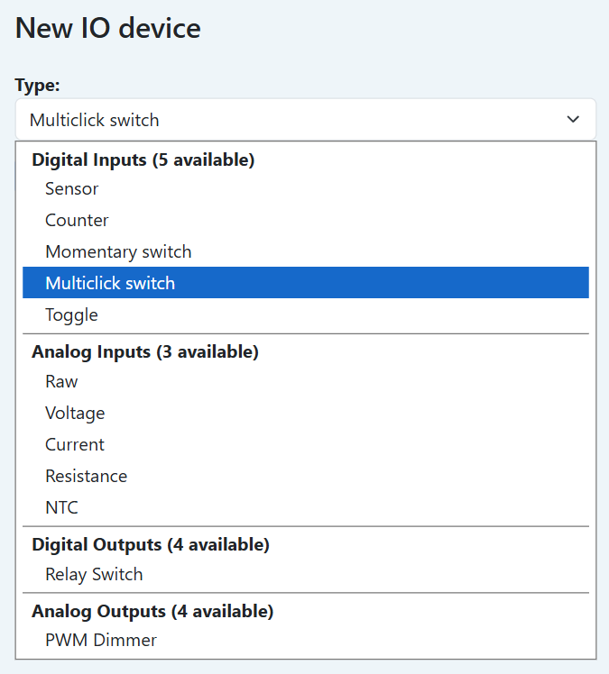
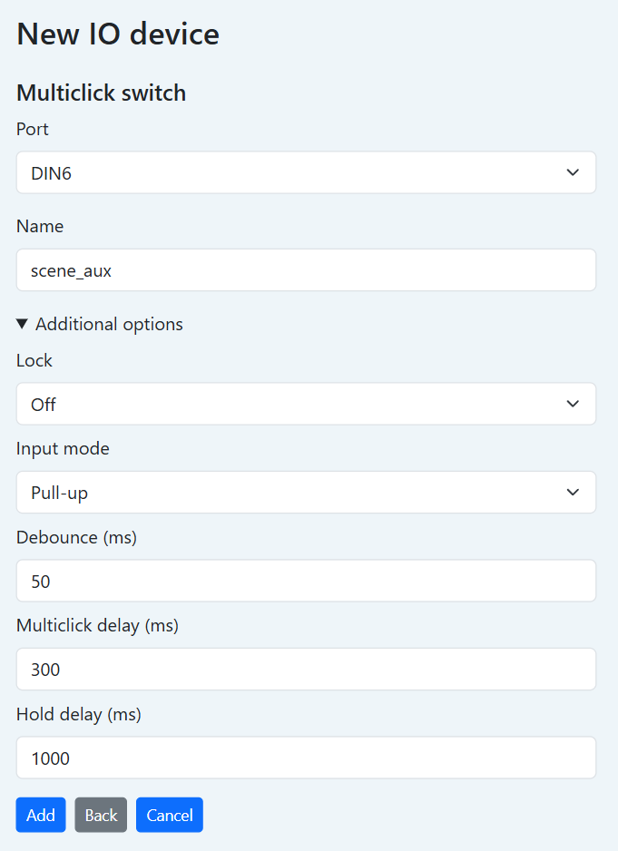
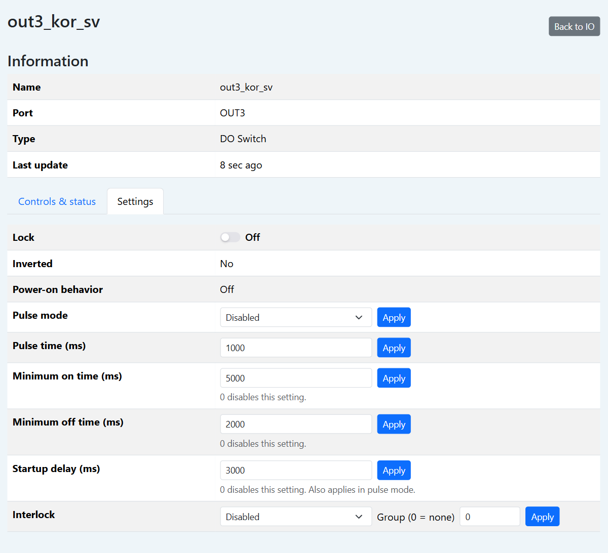
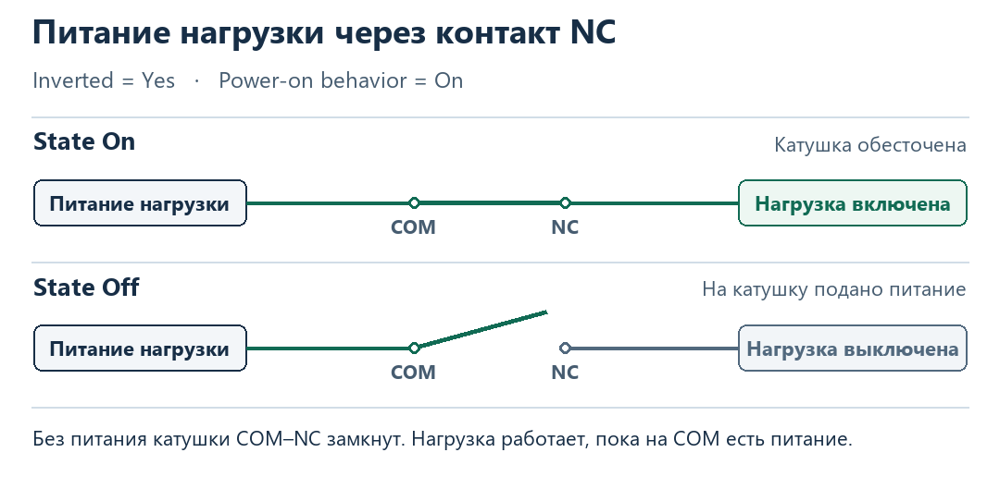
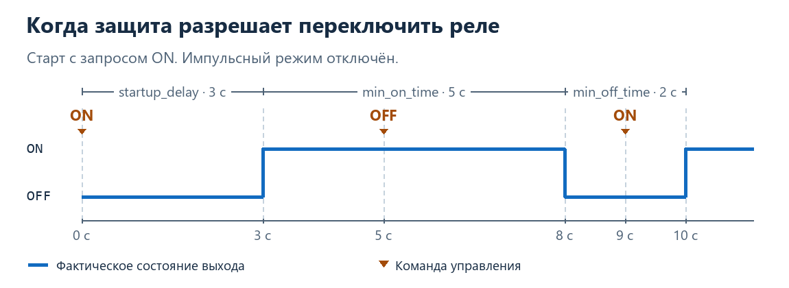
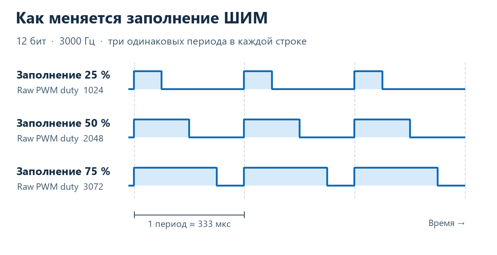

# Сервис IO

Сервис IO читает состояния кнопок и показания датчиков, управляет дискретными выходами и регулирует мощность нагрузки на ШИМ-выходах.

<a id="работа-с-io-gpio"></a>

## Оглавление

- [Список портов](#io-list)
- [Добавление порта](#io-add)
  - [Выбор клеммы и имени](#io-port-options) · [Карточка порта](#io-card)
- [Дискретные входы](#io-di-types)
  - [Как срабатывает мультиклик](#io-multiclick) · [Импульсный счётчик](#io-counter)
- [Аналоговые входы](#io-ai-types)
  - [Аналоговые измерения](#io-analog) · [Пересчёт 4–20 мА в давление 0–6 МПа](#io-pressure)
- [Дискретные выходы](#io-relay)
  - [Постоянно включённая нагрузка на NC](#io-relay-nc) · [Импульсы](#io-relay-pulse) · [Защитные интервалы](#io-relay-protection) · [Interlock](#io-interlock)
- [ШИМ-выход и настройки PWM Dimmer](#io-pwm)
- [Блокировка порта](#io-lock)
- [Сохранение и загрузка конфигурации](#io-save)
  - [Совместимость со старой конфигурацией Lua](#io-legacy-config) · [Переход на управление через IO](#io-migration)
- [Lua — запуск сервиса, объекты и сценарии](#io-lua)
  - [Справочник свойств io.get и io.set](#io-lua-properties)
- [MQTT](#io-mqtt)
  - [Автоматическое обнаружение в Home Assistant](#io-ha-discovery)
- [HTTP API](#io-http) · [WebSocket](#io-websocket)

<a id="io"></a>
<a id="io-list"></a>

## Список портов

Откройте **IO** в меню контроллера или перейдите на `/io`. Здесь можно добавить порт и открыть его настройки. В столбце **Port** указана маркировка клеммы на контроллере, например `DIN5` или `OUT3`. В **Name** отображается имя, по которому к порту обращаются в сценариях и через API, например `in5` или `out3_kor_sv`. Нажмите на имя, чтобы открыть карточку. Если страница сообщает, что сервис ещё не запущен, выполните [первичный запуск](#io-startup).


Значения и переключатели в таблице обновляются в реальном времени. В столбце **Info** сразу видно, как сработал контакт, какое действие распознала кнопка или как изменилось показание датчика. Дискретный выход можно переключить прямо в строке. Если его переключит сценарий или другой пользователь, новое положение сразу отобразится в открытой таблице.

**Last update** показывает, сколько времени прошло с последнего обновления значения. После синхронизации часов контроллера точное время доступно в подсказке при наведении.

Для поиска введите имя, клемму, тип или отображаемое значение. В **All types** можно выбрать несколько групп. Нажатие на заголовок столбца сортирует строки, повторное нажатие меняет направление. В **Actions** карандаш переименовывает порт, корзина удаляет его после подтверждения. После переименования используйте новое имя в привязках, подписках и командах управления.

<a id="io-add"></a>

## Добавление порта

Нажмите **+** справа над списком и раскройте поле **Type**. Заголовки групп показывают количество свободных совместимых клемм. На снимке свободны пять дискретных входов, три аналоговых и четыре выхода. В этом примере четыре выходные клеммы доступны в группах **Digital Outputs** и **Analog Outputs**. После назначения клеммы число свободных мест уменьшится в обеих группах. В группе с **0 available** выбор заблокирован.



<a id="io-port-options"></a>

### Выбор клеммы, имени и дополнительных параметров

1. После выбора типа нажмите **Next**. В **Port** выберите свободную клемму. Занятые клеммы помечены именами использующих их портов.
2. Введите **Name**. По умолчанию контроллер предлагает маркировку в нижнем регистре, например `din6`. Имя должно быть уникальным, длиной до 128 байт, без `/`, `+`, `#`, управляющих символов и пробелов по краям.
3. Раскройте **Additional options**. Для дискретных входов здесь задаются **Input mode** и **Debounce (ms)**. При **Pull-up** активным считается низкий уровень, при **Input** и **Pull-down** — высокий. Для **Multiclick switch** добавляются интервалы серии и удержания. Для аналогового входа укажите **Read interval (s)**, для дискретного выхода — поведение при включении питания, импульс и защитные интервалы.
4. Нажмите **Add**. Порт сразу появится в списке. **Back** возвращает к выбору типа, **Cancel** закрывает форму.



<a id="io-card"></a>

### Карточка порта

Нажмите имя порта в списке. Вверху карточки видны имя, клемма, тип и время обновления. На вкладке **Controls & status** находятся команды и текущие значения. **Settings** содержит настройки выбранного типа. Переключатели действуют сразу. Для поля с кнопкой **Apply** введите значение и нажмите эту кнопку.

<a id="io-di-types"></a>

## Digital Inputs — дискретные входы

| Тип в меню | Когда выбрать и что покажет порт |
| --- | --- |
| **Sensor** | Для датчиков протечки, открытия, дыма, движения и других бинарных датчиков с дискретным выходом. **Contact** показывает **Active** или **Inactive**. **Counter** увеличивается при каждом изменении контакта. |
| **Counter** | Для импульсных счётчиков воды, газа и других приборов с импульсным выходом. В карточке видны число импульсов и показание в выбранных единицах. [Как задать цену импульса](#io-counter). |
| **Momentary switch** | Устаревший тип для кнопки без фиксации. Формирует `press` при нажатии и `release` при отпускании. **Hold duration** показывает длительность нажатия. Все эти возможности есть в **Multiclick switch**. |
| **Multiclick switch** | Для кнопок и кнопочных выключателей без фиксации. Различает нажатие, отпускание, серию кликов и удержание, в том числе после одного или нескольких коротких кликов. |
| **Toggle** | Для классического выключателя с фиксацией или тумблера. **Contact** показывает текущее положение контакта. При каждом переходе из активного положения в неактивное **Toggle value** переключается между `0` и `1`. |

<a id="io-multiclick"></a>

### Как срабатывает мультиклик

**Multiclick switch** предназначен для кнопок и кнопочных выключателей без фиксации. Пока кнопка нажата, контакт активен. После отпускания он возвращается в исходное состояние. Поле **Action** в карточке показывает последнее распознанное событие.

**Настройки времени.** Три интервала задаются при добавлении входа в **Additional options**. В карточке их можно посмотреть на вкладке **Settings**. Диапазон каждого поля — целые значения от `0` до `65535` мс.

| Поле в форме | По умолчанию | От какого момента идёт отсчёт |
| --- | --- | --- |
| **Debounce (ms)** | 50 мс | Фильтрация физического контакта при нажатии и отпускании. Контроллер опрашивает кнопку с шагом 10 мс. От исходного устойчивого состояния при значении 50 мс требуется пять отсчётов нового уровня. Для `0` достаточно одного отсчёта. |
| **Multiclick delay (ms)** | 300 мс | Пауза от **последнего подтверждённого отпускания**. Если до завершения паузы началось следующее нажатие, оно входит в ту же серию. После его отпускания отсчёт начинается заново. |
| **Hold delay (ms)** | 1000 мс | Порог удержания от **начала текущего подтверждённого нажатия**. Для комбинации «клик, затем удержание» время удержания отсчитывается от второго нажатия. |

Времена на схеме отсчитываются после фильтрации дребезга. Метка `≈` означает событие по таймеру. Контроллер выдаёт его при обработке истёкшего интервала. При нулевом **Multiclick delay** результат может появиться уже при ближайшей обработке после отпускания. Нулевой **Hold delay** позволяет засчитать удержание с начала подтверждённого нажатия.


**Начало серии.** Первое подтверждённое нажатие даёт `press`. Если оно короткое, первое отпускание даёт `release`. У следующих коротких нажатий внутри этой серии отдельные `press` и `release` не публикуются. После паузы приходит один результат всей серии.

| Коротких нажатий подряд | Результат серии |
| --- | --- |
| 1 | `single` |
| 2 | `double` |
| 3 | `triple` |
| 4 | `quadruple` |
| От 5 до 255 | `many_N`, где `N` — число нажатий. Например, `many_5` и `many_12`. На предельном 255-м отпускании `many_255` выдаётся сразу. |

**Если последнее нажатие удерживать**, событие начала удержания приходит по достижении **Hold delay**. При отпускании приходит парное событие завершения. Ждать **Multiclick delay** после него не требуется. Короткие нажатия перед удержанием входят в имя комбинации. Отдельного `single` или `double` за них не будет.

| Коротких кликов перед удерживаемым нажатием | При удержании | При отпускании |
| --- | --- | --- |
| 0 — удерживается первое нажатие | `hold` | `hold_release` |
| 1 — удерживается второе | `single_hold` | `single_hold_release` |
| 2 — удерживается третье | `double_hold` | `double_hold_release` |
| 3 — удерживается четвёртое | `triple_hold` | `triple_hold_release` |
| 4 — удерживается пятое | `quadruple_hold` | `quadruple_hold_release` |
| От 5 до 254 | `many_N_hold` | `many_N_hold_release` |

В семействе `many_N_hold` число `N` включает удерживаемое нажатие. Например, пять коротких и удержание шестого дают `many_6_hold` и `many_6_hold_release`. При завершении удержания **Hold duration** показывает полное время от начала последнего нажатия до его отпускания, включая сам порог удержания. **Counter** у мультиклика считает выданные действия — одно короткое нажатие обычно увеличивает его на три (`press`, `release`, `single`).

**Примеры с настройками 50 / 300 / 1000 мс**

- Кнопку нажали в 0 мс и отпустили в 100 мс. События — `press` в 0, `release` в 100, `single` примерно в 400 мс. Если снова нажать после выдачи `single`, начнётся новая серия с `press`.
- К первому клику добавили нажатие с 240 до 340 мс. После первых `press` и `release` приходит `double` примерно в 640 мс. Результат считается от второго отпускания.
- Кнопку держали с 0 до 1300 мс. Последовательность — `press`, примерно в 1000 мс `hold`, в 1300 мс `hold_release`. Длительность — 1300 мс.
- Первый клик закончился в 100 мс, второе нажатие длилось с 240 до 1490 мс. Примерно в 1240 мс появится `single_hold`, в 1490 мс — `single_hold_release`. Длительность удержания — 1250 мс.

При отпускании контроллер сверяет отметки времени. Если порог уже достигнут, а событие удержания ещё не успело выйти, начало и завершение удержания могут прийти подряд. Если удержание уже объявлено, но по отметке отпускания длительность оказалась меньше порога, завершение имеет вид `release`, `single_release`, `double_release`, `triple_release`, `quadruple_release` или `many_N_release` с тем же правилом для `N`. Это уточнение времени при обработке переходов. Обычная серия коротких кликов завершается именем из первой таблицы.

Если свет должен переключаться сразу в начале нажатия, обрабатывайте `press`. Если одному и двум кликам нужны разные действия, используйте `single` и `double`. Привязка одного действия одновременно к `press` и `single` выполнит его дважды при одиночном клике.

При переносе сценария с **Momentary switch** учитывайте, что у старого типа каждое нажатие даёт `press`, а каждое отпускание — `release` и длительность. У **Multiclick switch** `press` отмечает начало серии. Короткое первое нажатие заканчивается `release`, а длительное — `hold_release` с длительностью в миллисекундах. Следующие нажатия внутри серии входят в общее событие.

<a id="io-counter"></a>

### Counter — импульсный счётчик

Выберите **Counter**, если прибор выдаёт один импульс на определённый объём воды или газа. При переходе входа из активного состояния в неактивное **Counter** увеличивается на единицу. **Value** показывает число учтённых импульсов, умноженное на **Multiplier**.

Введите цену одного импульса в **Settings → Multiplier**. Например, для водосчётчика с ценой импульса 10 л задайте `10`. После трёх импульсов в **Controls & status** появятся **Counter** = `3` и **Value** = `30` л.

На вкладке **Controls & status** можно изменить **Value** вручную. При следующем изменении контакта контроллер снова вычислит **Value** по числу учтённых импульсов и коэффициенту.

<a id="io-ai-types"></a>

## Analog Inputs — аналоговые входы

| Тип в меню | Когда выбрать и что покажет порт |
| --- | --- |
| **Raw** | Для чтения отсчётов АЦП, например при калибровке. **Raw ADC value** показывает целое число с учётом поправки **Calibration offset**. |
| **Voltage** | Для измерения напряжения. В карточке **Voltage** выводится в вольтах, например `13.33 V`. |
| **Current** | Для датчиков с токовым выходом, в том числе 4–20 мА. **Current** показывает ток в миллиамперах, **Sensor status** — состояние токовой линии. |
| **Resistance** | Для измерения сопротивления резистивного датчика. **Resistance** выводится в омах. |
| **NTC** | Для термистора с номиналом 10 кОм при 25 °C и коэффициентом B = 3950 К. **Temperature** показывает температуру в °C. |

Выберите тип, соответствующий сигналу датчика и измерительной цепи канала. Для каждого аналогового входа можно задать свой интервал чтения.

<a id="io-analog"></a>

### Аналоговые измерения

На вкладке **Controls & status** строка **Raw ADC value** показывает отсчёт АЦП с учётом поправки. Рядом выводится измерение выбранного типа, например **Current** в мА или **Voltage** в В. Включив **Conversion**, можно одновременно видеть исходное измерение и рассчитанную по нему величину.

| Поле | Как пользоваться |
| --- | --- |
| **Read interval** | Период чтения этого канала. При добавлении его задают в секундах, по умолчанию `5`. В карточке тот же интервал показан в миллисекундах, например `5000 ms`. Контроллер опрашивает добавленные и разблокированные каналы. Если отсчёт прежний, время последнего изменения остаётся прежним. |
| **Calibration offset** | Поправка к коду АЦП в отсчётах, от −32768 до 32767, по умолчанию `0`. Отрицательный результат сложения ограничивается нулём. |
| **Calibration scale** | Коэффициент, на который умножается измеренное напряжение перед вычислением тока, напряжения, сопротивления или температуры. По умолчанию `1`. Для типа **Raw** преобразование использует непосредственно отсчёты АЦП. |
| **Conversion status**, **Converted value** | Первое поле показывает состояние пересчёта, второе — его численный результат. В исходной конфигурации пересчёт отключён. Параметры шкалы задаются на вкладке **Settings**. |

<a id="io-pressure"></a>

### Как перевести 4–20 мА в давление 0–6 МПа

Пусть датчик подключён к `AIN1`. По его паспорту **4 мА соответствуют 0 МПа**, а **20 мА — 6 МПа**. Для такой характеристики достаточно задать две точки. Между ними изменение давления пропорционально изменению тока. Шкала начинается с 4 мА, поэтому на середине диапазона, при **12 мА**, давление равно **3 МПа**.

1. На странице **IO** нажмите **+ → Analog Inputs → Current → Next**. Выберите `AIN1`, введите имя `pressure` и нажмите **Add**. Если токовый вход уже создан, сразу откройте его по имени.
2. На вкладке **Settings** оставьте **Conversion** в положении **Disabled**, пока вводите границы. Заполните поля из таблицы, подтверждая каждое кнопкой **Apply**.
3. Переведите **Conversion** в **Enabled** и нажмите **Apply**. На вкладке **Controls & status** сравните **Current**, **Conversion status** и **Converted value**.

| Поле на вкладке Settings | В примере | Что задаёт |
| --- | --- | --- |
| **Input low** | `4` | Ток на нижней границе, мА. |
| **Output low** | `0` | Давление при 4 мА, в МПа. |
| **Input high** | `20` | Ток на верхней границе, мА. Должен быть больше **Input low**. |
| **Output high** | `6` | Давление при 20 мА, в МПа. |
| **Value below range** | `-1` | Значение, которое вернётся при токе строго ниже 4 мА. |
| **Value above range** | `-2` | Значение, которое вернётся при токе строго выше 20 мА. |


**Расчёт внутри диапазона.** Контроллер определяет, какую долю входной шкалы занимает измерение, и откладывает ту же долю на выходной шкале.

```text
Доля = (измерение − Input low) / (Input high − Input low)
Результат = Output low + Доля × (Output high − Output low)
```

Для нашего датчика каждый дополнительный 1 мА сверх 4 мА соответствует 0,375 МПа. Например, при 8 мА получим `(8 − 4) × 0,375 = 1,5` МПа. На обеих границах пересчёт ещё действует.


| Ток, мА | Давление, МПа | Conversion status |
| --- | --- | --- |
| 4 | 0,00 | Normal |
| 8 | 1,50 | Normal |
| 12 | 3,00 | Normal |
| 16 | 4,50 | Normal |
| 20 | 6,00 | Normal |

На снимке **Current** равен `12.00 mA`, **Converted value** — `3`. Единицу результата определяет выбранная шкала. В этом примере число в **Converted value** читается в мегапаскалях. Строка **Current** по-прежнему показывает исходный ток.


**Как отличить выход за шкалу от неисправности линии.** **Conversion status** сравнивает ток с введёнными границами 4 и 20 мА. **Sensor status** отдельно оценивает саму токовую линию. При токе до 3 мА включительно карточка показывает **Disconnected**, при токе от 25 мА включительно — **Short circuit**. Между этими порогами состояние линии — **Normal**.

| Ток | Sensor status | Conversion status | Что появится в Converted value |
| --- | --- | --- | --- |
| 0 мА | Disconnected | Below range | `-1` |
| 3,5 мА | Normal | Below range | `-1` |
| 21 мА | Normal | Above range | `-2` |
| 25 мА | Short circuit | Above range | `-2` |

Числа `-1` и `-2` выбраны для этого примера как признаки ошибки. В сценарии используйте результат как давление, когда **Conversion status** равен **Normal**. Для датчика с другой шкалой подставьте его паспортные пределы. Например, при шкале 0–60 бар можно задать **Output high** `60` и получать результат в барах.

У самой границы учитывайте округление. При измерении 3,999 мА строка **Current** покажет `4.00 mA`, а **Conversion status** — **Below range**. Контроллер сравнивает с границами полное значение до округления для экрана.

<a id="io-relay-type"></a>
<a id="io-relay"></a>

## Digital Outputs — дискретные выходы

Дискретный выход включает и выключает нагрузку. Его аппаратное исполнение зависит от модели контроллера и установленных в нём модулей. Это может быть электромеханическое реле, бесшумное симисторное реле или транзисторный выход. Для любого из этих исполнений при добавлении выберите **Digital Outputs → Relay Switch**.

На вкладке **Controls & status** переключатель **State** показывает логическое состояние выхода и позволяет его изменить. На вкладке **Settings** можно настроить импульс, защитные интервалы и взаимную блокировку выходов.

| Параметр | Как работает |
| --- | --- |
| **Inverted** | Меняет полярность сигнала управления выходом. В форме добавления по умолчанию **No**. |
| **Power-on behavior** | Определяет состояние при запуске. **Off** оставляет выход выключенным, **On** запрашивает включение. **Keep current level** (в карточке **Previous state**) учитывает аппаратный уровень, который контроллер может прочитать при инициализации. После полного снятия питания результат зависит от аппаратной схемы. |
| **Pulse mode**, **Pulse time (ms)** | Задают направление и длительность одиночного импульса. По умолчанию режим **Disabled**, время `1000` мс. |
| **Startup delay (ms)** | Через сколько миллисекунд после запуска контроллера разрешено включить выход. Действует и для **Power-on behavior → On**. |
| **Minimum on time (ms)** | Сколько выход должен оставаться включённым после фактического включения, прежде чем разрешено выключение. |
| **Minimum off time (ms)** | Сколько выход должен оставаться выключенным после фактического выключения, прежде чем разрешено следующее включение. |
| **Interlock** | Выбирает режим взаимной блокировки и номер группы выходов. |

**Inverted** и **Power-on behavior** задаются при добавлении, их текущие значения видны в **Settings**. Импульс, интервалы и группу можно изменить прямо в карточке.



<a id="io-relay-nc"></a>

### Постоянно включённая нагрузка на нормально замкнутом контакте NC

Например, роутер должен работать постоянно, а контроллеру нужно изредка выключать его для перезагрузки. Для такой схемы подойдёт электромеханическое реле без фиксации, у которого выведены общий контакт **COM** и нормально замкнутый контакт **NC**. Питание роутера пропускают через эту пару. Пока катушка обесточена, цепь **COM–NC** замкнута и роутер получает питание.

В этом примере выход при обычной полярности подаёт питание на катушку по команде **On**. При добавлении **Relay Switch** раскройте **Additional options** и задайте **Inverted → Yes** и **Power-on behavior → On**. Теперь переключатель **State** соответствует питанию роутера. Оставьте **Startup delay (ms) → 0**, чтобы при запуске IO сразу применил **On**. При заданной задержке IO может на время ожидания перевести нагрузку в **Off**.

| Ситуация | Катушка реле | Контакт COM–NC | Питание роутера |
| --- | --- | --- | --- |
| IO запустился с **Power-on behavior → On** или получена команда **State → On** | Обесточена | Замкнут | Включено |
| Применена команда **State → Off** | Под напряжением | Разомкнут | Выключено |
| Контроллер обесточен и питание катушки пропало | Обесточена | Замкнут | Включено, если сохранилось питание самого роутера |



Для автоматической перезагрузки задайте **Pulse mode → Pulse OFF** и, например, **Pulse time (ms) → 5000**. Одной команды **Off** достаточно, чтобы отключить роутер на пять секунд. Контроллер сам вернёт **On**, даже если на время перезагрузки связь с веб-интерфейсом пропадёт. При **Pulse mode → Disabled** питание возвращают отдельной командой **On**.

При потере питания контроллера или при отказе, который снимает напряжение с катушки, контакт **COM–NC** замыкается механически. Нагрузка продолжит работу или снова получит питание, если была выключена. Для этого её источник питания должен оставаться доступным. При зависании контроллера выход может удерживать катушку под напряжением. В таком случае **COM–NC** останется разомкнутым до обесточивания катушки.

<a id="io-relay-pulse"></a>

### Импульс на включение или выключение

Если выход должен включаться на полсекунды, установите **Pulse mode → Pulse ON** и **Pulse time (ms) → 500**. Команда **On** включит выход на 500 мс. Затем он вернётся в **Off**. Для выхода, который обычно включён, задайте **Power-on behavior → On** и **Pulse mode → Pulse OFF**. Тогда команда **Off** выключит его на заданное время и выход самостоятельно вернётся в **On**.

Импульс запускает переход в выбранное состояние. Повтор той же команды во время импульса сохраняет исходный срок завершения. Установка начального уровня при запуске сама по себе импульс не запускает. Длительность задаётся целым числом от 1 до 4 294 967 295 мс. Фактическое время переключения контактов механического реле зависит также от его конструкции.

<a id="io-relay-protection"></a>

### Задержка старта и защита от частых переключений

**Startup delay** помогает разнести запуск мощных устройств с большим пусковым током. Например, для трёх выходов с **Power-on behavior → On** задайте задержки `5000`, `15000` и `25000` мс. При обычном запуске, когда IO уже инициализирован к этим моментам, первое устройство сможет включиться через 5 секунд от старта контроллера, второе через 15, третье через 25. Пусковые токи этих устройств приходятся на разное время. Это разовая задержка от старта контроллера. Последующие включения регулирует **Minimum off time**.


**Minimum off time** и **Minimum on time** помогают защитить насосы и компрессоры от частых включений и выключений. Первое ограничение выдерживает паузу перед повторным пуском после остановки, второе обеспечивает минимальную продолжительность работы после пуска. Интервалы выбирают по требованиям конкретного оборудования. Например, если компрессору нужна пауза **3 минуты** между остановкой и следующим пуском, задайте **Minimum off time (ms) → 180000**.

У всех трёх интервалов `0` отключает ограничение, рабочий диапазон — от 1 до 4 294 967 295 мс. Если команда поступила раньше срока, выход остаётся в прежнем состоянии. Под переключателем появится время ожидания, например **Off in 3 s**. Повтор той же команды сохраняет срок, а команда возврата к текущему уровню отменяет ожидающий переход. В режиме **Pulse ON** или **Pulse OFF** из трёх ограничений действует только **Startup delay**. Оба минимальных времени снова действуют после возврата в **Disabled**.



<a id="io-interlock"></a>

### Взаимная блокировка дискретных выходов

На вкладке **Settings** выберите режим **Interlock**, введите номер группы от `1` до `65535` и нажмите **Apply**. Для всех участников одной группы нужен одинаковый режим.

| Режим | Что произойдёт |
| --- | --- |
| **Disabled** | Выход работает самостоятельно. Номер группы `0` используется для выхода из группы. |
| **Only one relay on** | Перед включением выбранного выхода контроллер выключает остальные включённые выходы группы. Например, при включении `channel_b` сначала выключится `channel_a`. |
| **Only one relay off** | Перед выключением выбранного выхода контроллер включает остальные выключенные выходы группы. |

Если защитный интервал другого выхода ещё действует, запрос ждёт разрешённого момента. Если необходимое переключение другого выхода запрещено его **Lock**, контроллер отклоняет команду.

<a id="io-pwm-type"></a>
<a id="io-pwm"></a>

## Analog Outputs — ШИМ-выход PWM Dimmer

Выберите **PWM Dimmer**, чтобы регулировать среднюю мощность нагрузки, например светодиодной ленты. Выходной каскад и нагрузка должны поддерживать ШИМ. **Частота** задаёт, сколько раз в секунду повторяется импульс, **заполнение** — какую долю периода выход активен. На вкладке **Controls & status** переключатель **State** включает и выключает нагрузку. Ползунок **Brightness** регулирует яркость света. Чтобы задать заполнение напрямую, введите **Raw PWM duty**.


| Controls & status | Что можно сделать |
| --- | --- |
| **State** | Включить или выключить выход. При выключении заполнение становится нулевым. При следующем включении восстанавливается последняя ненулевая яркость в пределах текущего сеанса работы. После запуска первое включение использует верхнюю границу сохранённой шкалы яркости. |
| **Brightness** | Ползунок от `0` до **Brightness scale** (по умолчанию `255`). Ноль выключает выход. Ненулевое значение включает его и преобразуется в заполнение по экспоненциальной кривой с учётом **PWM minimum** и **PWM maximum**. |
| **Raw PWM duty** | Целое число от `0` до **PWM physical maximum**. Значение записывается напрямую, в обход шкалы яркости и настроенных пределов яркости. Ноль выключает выход. Прямая запись меняет состояние и заполнение, прежняя пользовательская яркость сохраняется. |

| Settings | По умолчанию | Диапазон и действие |
| --- | --- | --- |
| **Lock** | Off | Фиксирует выход на текущем уровне. Подробности — в [разделе о блокировке](#io-lock). |
| **Inverted** | No | Общий параметр формы выходов. Драйвер **PWM Dimmer** использует обычную полярность. |
| **Power-on behavior** | Off | Общий параметр формы выходов. Драйвер **PWM Dimmer** при запуске устанавливает нулевое заполнение. |
| **PWM frequency (Hz)** | 3000 Гц | Целое число от 100 до 15000 Гц. При изменении частоты драйвер перезапускает ШИМ, выключает выход и сбрасывает **PWM minimum** и **PWM maximum**. |
| **PWM resolution (bits)** | 12 бит | От 8 до 12 бит. Определяет число ступеней заполнения. Изменение разрешения также выключает выход и сбрасывает оба предела. |
| **PWM physical maximum** | 4096 при 12 битах | Верхняя граница прямого заполнения, только для чтения. Вычисляется как 2 в степени разрешения. При 8, 9, 10, 11 и 12 битах это соответственно 256, 512, 1024, 2048 и 4096. |
| **PWM minimum** | 1 | Минимальное заполнение для ненулевой яркости. Допускается от `1` до **PWM maximum**. Например, предел можно поднять до уровня, при котором светодиодная лента начинает светиться. Изменение выключает выход. |
| **PWM maximum** | Физический максимум | Максимальное заполнение для команды яркости. Допускается от **PWM minimum** до **PWM physical maximum**. Ограничивает верхний уровень. Изменение выключает выход. |
| **Brightness scale** | 255 | Верхняя граница пользовательской яркости, целое число от 2 до 65535. Например, значение `100` даёт ползунок `0…100`. Изменение выключает выход. |
| **Brightness step (%)** | 10 % | Размер шага команд `STEP_UP` и `STEP_DOWN`, от 1 до 255 % пользовательской шкалы. Шаг округляется, минимум — одна единица. При шкале 255 шаг 10 % составляет 26 единиц. Из выключенного состояния первый шаг вверх устанавливает яркость `1`. |


Частоту и разрешение задаёт один аппаратный таймер. Доступность конкретной пары зависит от контроллера. Для более высокой частоты может потребоваться меньшее разрешение.

**Пример для 12 бит.** При **Raw PWM duty** `1024`, `2048` и `3072` выход активен соответственно 25, 50 и 75 % периода. При частоте 3000 Гц период равен примерно 333 мкс. При заводских настройках ползунка **Brightness → 128** даёт **Raw PWM duty → 66**, то есть около 1,6 % периода. Для ровно 50 % задайте **Raw PWM duty → 2048**.



<a id="io-lock"></a>

## Блокировка порта

**Lock** временно блокирует порт. Для выхода блокировка запрещает запуск и любые новые команды, адресованные этому выходу IO из сценариев, API и интерфейсов контроллера, в том числе из Lua, веб-интерфейса и MQTT. Например, при работающем контроллере выключенный насос останется выключенным и при срабатывании расписания, и при нажатии кнопки в интерфейсе. Уже включённый дискретный выход сохранит текущее состояние.

Для блокировки откройте карточку порта и включите **Settings → Lock**. В карточке появится пометка **Locked**.


| Порт | Пока включён Lock | После снятия блокировки |
| --- | --- | --- |
| Дискретный вход | Фиксируются текущее значение, последнее действие кнопки и счётчик. Серия кликов прерывается. | Контроллер считывает фактический уровень контакта. Нажатия и импульсы за время блокировки пропускаются. Следующее нажатие начинает новую серию. |
| Аналоговый вход | Сохраняются последнее измерение и результат преобразования. | Чтение возобновляется с текущего сигнала. |
| Дискретный выход | Новые команды управления блокируются. Отложенный защитной паузой переход отменяется. Уже начатый импульс завершается в положенное время с возвратом в исходное состояние. | Доступны новые команды. Для отменённого перехода потребуется новая команда. |
| PWM Dimmer | Текущее заполнение сохраняется. Блокируются управление состоянием, яркостью и прямым заполнением, а также настройки, изменение которых само переключает выход. | Снова доступны переключатель, ползунок и прямое задание заполнения. |

Чтобы вернуть управление, выключите **Settings → Lock**. Состояние самой блокировки входит в конфигурацию порта. Если оно было сохранено, порт останется заблокированным и после перезапуска IO.

**При старте контроллера** дискретный выход принимает состояние, заданное в **Power-on behavior**, даже при сохранённой блокировке. Если выбрано **On**, выход может включиться при старте с учётом **Startup delay**. Для насоса, который при подаче питания должен оставаться выключенным, выберите **Power-on behavior → Off** при добавлении выхода.

<a id="io-save"></a>

## Сохранение и загрузка конфигурации

При запуске сервиса IO контроллер читает `/io.json` и восстанавливает имена, типы и настройки портов с привязкой к клеммам. В файле есть запись на каждый настроенный порт. Внутри записи сохраняются только отличия от значений по умолчанию. Например, при стандартном имени `din1` и стандартных настройках входа достаточно записи `"DIN1": {}`.

Добавление, переименование, удаление порта или изменение настройки вступает в силу сразу. Запись в файл происходит **через 60 секунд после последнего изменения конфигурации**. Каждая следующая правка начинает отсчёт заново. Файл записывается только при наличии отличий от сохранённой версии. Если за время ожидания вернуть все настройки к сохранённым значениям, запись пропускается. Текущие измерения, счётчики импульсов, состояния дискретных выходов и текущая яркость ШИМ в конфигурацию не входят.

Оранжевая дискета справа вверху страницы означает, что есть несохранённые изменения. Наведите на неё указатель, чтобы увидеть оставшееся время. После успешной записи значок исчезает. При ошибке записи в подсказке появится время до повторной попытки. Перед перезапуском дождитесь сохранения, если хотите восстановить последние изменения.


<a id="io-legacy-config"></a>
<a id="io-addgpioinput"></a>
<a id="io-addgpiooutput"></a>
<a id="io-addextanaloginput"></a>

### Если порты по-прежнему объявлены в Lua

Старые команды добавления работают как раньше. При первом запуске без сохранённых портов сценарий создаст их, и IO автоматически запишет конфигурацию. При следующих запусках IO сначала восстанавливает `/io.json`, затем выполняются строки сценария, расположенные после `io.begin(...)`. Объявление сопоставляется с существующим портом по аппаратной клемме. Повторно добавлять эти порты через веб не требуется.

| Что записано в старом сценарии | Что произойдёт при его выполнении |
| --- | --- |
| Объявлена свободная клемма | IO создаст порт. Поэтому порт, удалённый через веб, может снова появиться, пока его объявление активно. |
| Та же клемма и те же настройки | Существующий порт сохраняет своё состояние. Совпадение параметров само по себе не запускает запись файла. |
| Та же клемма и явно заданное другое значение | Сценарий изменит соответствующую настройку, если порт допускает изменение. Например, явно указанные `100` мс подавления дребезга заменят сохранённые `50` мс. Изменение включится в обычное автосохранение. |
| У порта того же типа необязательный параметр опущен | IO использует сохранённое значение этого параметра. Например, если в объявлении реле указан только выход и его имя, настроенная через веб длительность импульса сохранится. |
| Порт переименован в веб-интерфейсе, а в старом объявлении осталось его исходное имя | По той же клемме IO узнает порт и сохранит выбранное в веб-интерфейсе имя. В подписках и обработчиках используйте актуальное имя. |


<a id="io-migration"></a>

### Как перейти на полное управление портами через IO

1. Один раз запустите контроллер с действующим старым сценарием. Откройте **IO** и сверьте **Port**, **Name**, тип и важные настройки с прежней конфигурацией. Убедитесь, что все нужные порты появились, и дождитесь исчезновения оранжевой дискеты.
2. В `/init.lua` и вызываемых им файлах закомментируйте строки **добавления портов**. Если при старте сценарий отдельно задаёт постоянные параметры, например калибровку, коэффициент счётчика или параметры импульса, сверьте их с карточками и закомментируйте эти строки тоже. Иначе при запуске они снова запишут свои значения.
3. Оставьте загрузку модуля `require "io"` и существующий вызов `io.begin(...)` с прежней настройкой MQTT. Этот вызов пока нужен для запуска сервиса и чтения файла. Сохраните обработчики событий и команды автоматики, например переключение света по кнопке.
4. При следующем перезапуске проверьте, что порты, их имена и параметры восстановились, а обработчики по именам по-прежнему работают. После этого добавляйте, переименовывайте, удаляйте и настраивайте порты на странице **IO**.

<a id="io-lua"></a>

## Lua — запуск сервиса, объекты и сценарии

<a id="io-startup"></a>
<a id="io-begin"></a>

### Запуск сервиса

Сейчас для запуска IO при включении контроллера нужен вызов в `/init.lua`. Это временный способ запуска. Достаточно загрузить модуль и один раз вызвать `io.begin`. После этого портами можно управлять через веб.

```lua
require "io"
io.begin(false)
```

Аргумент `false` оставляет доступными страницу IO, HTTP API, WebSocket и сценарии. Аргумент `true` дополнительно включает публикацию IO в MQTT при настроенном подключении к брокеру. Обработчику, который использует `io`, достаточно `require "io"`.

### Объекты и события

Сейчас сервис автоматически связывает события и значения с объектами вида `io.<имя>.<свойство>`. Например, кнопка `in5` записывает действие в `io.in5.value`, а завершённую длительность в миллисекундах — в `io.in5.duration`. У входа `pressure` доступны измеренный ток `io.pressure.current` и преобразованное давление `io.pressure.value`. Эта автоматическая привязка временная. Для событий планируются поля `action`, в которых можно будет указать имя объекта, выбрать запуск сценария или записать код для непосредственного выполнения. В текущей версии поле **Action** в карточке кнопки показывает последнее событие.

<a id="io-get"></a>
<a id="io-set"></a>
<a id="io-lua-properties"></a>

### Справочник свойств io.get и io.set

`io.get(name, property)` читает свойство, `io.set(name, property, value)` задаёт новое значение. Указывайте имя порта из столбца **Name**. Имена порта и свойства распознаются без учёта регистра. Если сервис ещё не запущен, порт или свойство не найдены, `io.get` возвращает `nil`. В таблицах прочерк в колонке **io.set** означает, что для этого типа порта свойство доступно только на чтение.

Успешный `io.set` завершается без возвращаемых значений. Для конфликта режимов interlock или блокировки другого выхода возможен ответ `nil, "interlock_conflict"` или `nil, "interlock_locked"`. Отсутствие результата само по себе не подтверждает выполнение команды. Проверить значение можно через `io.get`. При защитной задержке состояние выхода изменится после окончания ожидания.

| Задача | Пример вызова |
| --- | --- |
| Прочитать контакт или последнее действие кнопки | `io.get("in5", "contact")` или `io.get("in5", "action")` |
| Прочитать состояние реле | `io.get("out3_kor_sv", "state")` |
| Проверить шкалу и прочитать давление | `io.get("pressure", "conv_status")` и `io.get("pressure", "value")` |
| Заблокировать или разблокировать вход | `io.set("in5", "lock", true)` или `io.set("in5", "lock", false)` |
| Изменить яркость на один шаг | `io.set("strip", "brightness", "STEP_UP")` |
| Задать прямое заполнение 50 % при 12 битах | `io.set("strip", "pwm_raw", 2048)` |

#### Общие свойства

| Свойство | io.get | io.set |
| --- | --- | --- |
| `lock` | Для любого порта. Логическое `true`, если порт заблокирован, иначе `false`. | `true` или `false`. Также принимаются `1`, `0` и строки `"on"`, `"off"`, `"true"`, `"false"`, `"1"`, `"0"`. |
| `state` | Для **Relay Switch** и **PWM Dimmer**. Строка `"ON"` или `"OFF"` показывает применённое состояние. | Строка `"ON"`, `"OFF"` или `"TOGGLE"`. Для подключения через NC смысл команд показан в [примере с роутером](#io-relay-nc). |

При включённой блокировке свойства доступны для чтения. На выходах блокируются команды управления, на входе **Counter** — запись `value`, на аналоговом входе — переключение `conv_enable`. Коэффициент счётчика, параметры калибровки и границы преобразования можно менять и при блокировке. Подробнее о поведении при разблокировке см. в [описании Lock](#io-lock).

#### Дискретные входы

| Свойство | io.get | io.set |
| --- | --- | --- |
| `contact` | Логическое состояние контакта у любого дискретного входа. `true` означает активный контакт. | — |
| `action` | У **Momentary switch** и **Multiclick switch** — строка последнего действия. У **Toggle** — строка `"0"` или `"1"`. До первого события возможно `nil`. **Sensor** и **Counter** действий не формируют. | — |
| `value` | Только **Counter**. Число с учётом коэффициента `multiplier`. | Число. Следующий переход входа пересчитает показание из числа импульсов и коэффициента. |
| `multiplier` | Только **Counter**. Числовой коэффициент пересчёта импульсов, по умолчанию `1`. | Число, например `0.5` литра на импульс. |

Само число импульсов доступно через `obj.get("io.water.counter")` для порта `water`. Длительность завершённого нажатия или удержания у кнопки `in5` доступна в `obj.get("io.in5.duration")` в миллисекундах. Для событий кнопки используйте `io.get("in5", "action")`.

#### Дискретные выходы

У дискретного выхода типа **Relay Switch** также доступны общие свойства `state` и `lock`.

| Свойство | io.get | io.set |
| --- | --- | --- |
| `pulse_mode` | Строка `"DISABLED"`, `"ON"` или `"OFF"`. | Один из этих режимов. `"ON"` задаёт импульс включения, `"OFF"` — выключения. |
| `pulse_time` | Длительность импульса в мс, по умолчанию `1000`. | Целое от `1` до `4294967295` мс. |
| `min_on_time` | Минимальное время работы от фактического включения, мс. | Целое от `0` до `4294967295` мс. Ноль отключает ограничение. |
| `min_off_time` | Минимальная пауза от фактического выключения до следующего пуска, мс. | Целое от `0` до `4294967295` мс. Ноль отключает ограничение. |
| `startup_delay` | Задержка первого разрешённого включения от старта контроллера, мс. | Целое от `0` до `4294967295` мс. Действует также при импульсном режиме. |
| `interlock_mode` | Строка `"disabled"`, `"on"` или `"off"`. | Один из этих режимов. У всех выходов одной группы режим должен совпадать. |
| `interlock_group` | Номер группы, целое число. | От `1` до `65535` — номер группы, `0` — выход из группы. |

При записи `interlock_mode` и `interlock_group` меняются по отдельности. Чтобы перевести выход в группу с другим режимом, сначала задайте `interlock_group` равным `0`, затем установите новый режим и номер целевой группы.

#### ШИМ-выходы

У **PWM Dimmer** также доступны `state` и `lock`. Примеры того, как соотносятся яркость и заполнение, приведены в [описании карточки PWM](#io-pwm).

| Свойство | io.get | io.set |
| --- | --- | --- |
| `brightness` | Число в пользовательской шкале. При выключенном выходе хранится последняя ненулевая яркость. | Целое от `0` до `brightness_scale` или строка `"STEP_UP"` / `"STEP_DOWN"`. Ноль выключает выход. |
| `brightness_scale` | Верхняя граница шкалы яркости, по умолчанию `255`. | Целое от `2` до `65535`. |
| `brightness_step` | Шаг изменения яркости в процентах шкалы, по умолчанию `10`. | Целое от `1` до `255`. Применяется к командам шага. |
| `pwm_freq` | Частота ШИМ, Гц. | Целое от `100` до `15000` Гц с учётом выбранного разрешения. |
| `pwm_res` | Разрешение ШИМ в битах. | Целое от `8` до `12`. |
| `pwm_phys_max` | Физический максимум заполнения для выбранного разрешения. Например, `4096` при 12 битах. В HTTP это поле называется `pwm_physical_max`. | — |
| `pwm_min` | Нижний предел заполнения для ненулевой яркости. | Целое от `1` до `pwm_max`. |
| `pwm_max` | Верхний предел заполнения для команды яркости. | Целое от `pwm_min` до `pwm_phys_max`. |
| `pwm_raw` | Прямое заполнение в единицах драйвера. | Целое от `0` до `pwm_phys_max`. Например, при 12 битах `2048` соответствует заполнению 50 %. |

#### Аналоговые входы

| Свойство | io.get | io.set |
| --- | --- | --- |
| `value_raw` | Целый отсчёт АЦП с учётом калибровочной поправки. | — |
| `current` | Измеренный ток в мА для **Current**. | — |
| `voltage` | Измеренное напряжение в В для **Voltage**. | — |
| `error` | Строка состояния токовой линии **Current**. Возможны `"normal"`, `"down"` и `"short"`. | — |
| `cal_raw` | Поправка в отсчётах АЦП, по умолчанию `0`. | Целое от `-32768` до `32767`. |
| `cal_scale` | Коэффициент калибровки напряжения, по умолчанию `1`. | Число. |
| `conv_enable` | Логическое `true`, если включено преобразование в физическую величину. | **Строка** `"true"` или `"false"`. Сначала задайте обе границы входной шкалы. |
| `conv_low_from` | Нижняя граница измеренного сигнала (**Input low**). | Число, меньшее `conv_high_from` для рабочей шкалы. |
| `conv_high_from` | Верхняя граница измеренного сигнала (**Input high**). | Число, большее `conv_low_from` для рабочей шкалы. |
| `conv_low_to` | Значение физической величины на нижней границе (**Output low**). | Число в выбранных единицах. |
| `conv_high_to` | Значение физической величины на верхней границе (**Output high**). | Число в тех же единицах. |
| `conv_err_low` | Результат для сигнала ниже шкалы (**Value below range**). | Число. |
| `conv_err_high` | Результат для сигнала выше шкалы (**Value above range**). | Число. |
| `conv_status` | Строка `"normal"`, `"low"` или `"high"`, характеризующая последнее преобразование. | — |
| `value` | Результат преобразования. Например, у `pressure` — давление в МПа. | — |

У аналоговых входов имена `current` и `voltage` читают одно поле. Его единицу определяет тип порта. Вызов `io.get("pressure", "voltage")` для датчика **Current** вернёт то же число в мА, что и `io.get("pressure", "current")`. Для **Resistance** и **NTC** физическую величину удобно читать через объекты `io.<имя>.resistance` и `io.<имя>.temperature` с помощью `obj.get`.

Используйте `value` и `conv_status` при `conv_enable == true`. Пока преобразование выключено, эти два свойства могут содержать прежнее или начальное значение. Дробные значения аналогового входа `io.get` возвращает с округлением до двух знаков после запятой, а `value` и `multiplier` дискретного счётчика — до трёх.

**Параметры формы добавления.** Инверсию, состояние при старте, режим входа и интервалы задают при добавлении соответствующего порта. Их текущие значения возвращает `GET /api/io?id=<имя>` в полях `invert`, `power_on_behavior`, `pin_mode`, `debounce_ms`, `send_delay_ms`, `hold_delay_ms` и `read_interval_ms`. Эти поля отсутствуют в списке свойств `io.get` и `io.set`.

### Пример — кнопка переключает свет

На странице **IO** добавьте вход `DIN5` типа **Multiclick switch** с именем `in5` и выход `OUT3` типа **Relay Switch** с именем `out3_kor_sv`. В `/init.lua` после запуска сервиса привяжите обработчик к объекту кнопки.

```lua
obj.setScript("io.in5.value", "/hall-light.lua", true)
```

Сохраните обработчик в файле `/hall-light.lua`. Проверка `Event.Value` переключает свет сразу по первому нажатию серии. Последующие события той же серии оставляют свет в выбранном состоянии.

```lua
require "io"

if Event.Value == "press" then
    io.set("out3_kor_sv", "state", "TOGGLE")
end
```

<a id="gpio"></a>

### Прямой доступ к свободным выводам

Для собственных схем доступны низкоуровневые вызовы `gpio`. Используйте их для свободных выводов. Команды именованным портам отправляйте через `io.set`, чтобы сервис учитывал их состояние, блокировку и защитные интервалы.

| Вызов | Назначение |
| --- | --- |
| <a id="gpio-mode"></a>`gpio.mode(pin, mode)` | Установить `gpio.INPUT`, `gpio.INPUT_PULLUP`, `gpio.INPUT_PULLDOWN` или `gpio.OUTPUT`. |
| <a id="gpio-read"></a>`gpio.read(pin)`, `gpio.read(pin, true)` | Прочитать цифровой уровень или код встроенного АЦП на совместимом выводе. |
| <a id="gpio-write"></a>`gpio.write(pin, value)` | Установить `gpio.HIGH`, `gpio.LOW` или выполнить `gpio.TOGGLE`. |
| <a id="pwm-шим"></a><a id="gpio-pwmsetup"></a>`gpio.pwmSetup(pin[, freq[, resolution]])` | Задать частоту и разрешение ШИМ. У этого низкоуровневого вызова исходные значения — 5000 Гц и 8 бит. |
| <a id="gpio-pwm"></a>`gpio.pwm(pin, duty)` | Установить заполнение в единицах выбранного разрешения. |
| `gpio.pwmFade(pin, start, target, time)` | Плавно изменить заполнение за указанное время в миллисекундах. |

Подробнее о сценариях и прямой работе с выводами. [Руководство по Lua](https://slsys.io/lua) · [Примеры работы с GPIO](https://slsys.io/gpio_sample).

<a id="io-mqtt"></a>

## MQTT

При включённой публикации IO отправляет состояние порта в `<prefix>/io/<имя>`. Вместо `<prefix>` подставьте префикс своего контроллера. Сообщение содержит объект JSON. Для дискретного выхода поле `state` принимает `"ON"` или `"OFF"`. Кнопка публикует действие в `action`, а при завершённом удержании — также `duration` в миллисекундах. У токового входа `current` показывает мА, при включённом пересчёте `value` содержит рассчитанную величину, а `conv_status` — `"normal"`, `"low"` или `"high"`.

| Что сделать | Топик | Данные |
| --- | --- | --- |
| Прочитать давление из примера | Подписаться на `<prefix>/io/pressure` | При 12 мА в сообщении будут `"current":12`, `"value":3` и `"conv_status":"normal"`. |
| Включить реле | `<prefix>/io/out3_kor_sv/set/state` | `ON` |
| Переключить реле | `<prefix>/io/out3_kor_sv/set` | `{"state":"TOGGLE"}` |
| Задать яркость | `<prefix>/io/strip/set/brightness` | `128` |

<a id="io-ha-discovery"></a>

### MQTT HA Discovery — автоматическое обнаружение в Home Assistant

С помощью **HA MQTT Discovery** Home Assistant автоматически добавляет порты IO как сущности MQTT. В каталоге **Devices** контроллера каждый порт показан отдельной строкой. В Home Assistant эти сущности собраны в одном устройстве контроллера.

1. Подключите контроллер и интеграцию **MQTT** в Home Assistant к одному брокеру. Для публикации значений портов включите MQTT в контроллере и укажите `io.begin(true)` при [запуске IO](#io-startup).
2. На контроллере откройте **Devices → Settings** (шестерёнка). Проверьте **HA Discovery topic prefix**. По умолчанию это `homeassistant`. В настройках интеграции MQTT в Home Assistant должен быть включён Discovery с тем же префиксом. Если хотите публиковать весь каталог **Devices**, включите **HA MQTT Discovery**. Сохраните настройки кнопкой **Save**.
3. Чтобы опубликовать только отдельные порты, оставьте общий переключатель выключенным и включите значок Home Assistant в столбце **Discovery** у нужных строк. В **Edit** порта или отдельной сущности доступны **On**, **Off** и **Inherit**. При наследовании сущность берёт настройку порта, а порт — общую настройку.
4. В Home Assistant откройте **Настройки → Устройства и службы → MQTT**, затем устройство контроллера. В нём появятся сущности выбранных портов.

| Тип порта IO | Что появится в Home Assistant |
| --- | --- |
| **Sensor** | Двоичный датчик (`binary_sensor`). Поле `contact` показывает активное или неактивное состояние контакта. |
| **Counter** | Две сущности. Двоичный датчик показывает контакт, а числовой датчик (`sensor`) — показание `value` с учётом **Multiplier**. |
| **Multiclick switch**, **Momentary switch** | Текстовый датчик (`sensor`) с последним действием из поля `action`, например `press` или `double`. При повторной публикации конфигурации контроллер не воспроизводит прошлое нажатие. |
| **Toggle** | Двоичный датчик по полю `value` со значением `0` или `1`. |
| **Raw**, **Voltage**, **Current**, **Resistance**, **NTC** | Числовой датчик с отсчётом АЦП, напряжением (В), током (мА), сопротивлением (Ом) или температурой (°C). |
| **Relay Switch** | Переключатель (`switch`) для включения и выключения дискретного выхода. |
| **PWM Dimmer** | Светильник (`light`) с включением, выключением и регулировкой яркости по шкале порта. |

Например, у входа `pressure` из [примера с датчиком давления](#io-pressure) автоматически появится датчик тока в мА. Чтобы видеть и давление, включите **Conversion** в карточке входа и добавьте в Home Assistant отдельный MQTT-сенсор. Укажите топик `<prefix>/io/pressure` и единицу `МПа`. Шаблон ниже берёт поле `value` только при нормальном статусе пересчёта, чтобы код выхода за диапазон не попал в историю как измеренное давление. [Настройка MQTT-сенсора в Home Assistant](https://www.home-assistant.io/integrations/sensor.mqtt/).

```jinja
{{ value_json.value if value_json.get('conv_status') == 'normal' else none }}
```

**Как проверить публикацию.** Пусть MQTT-префикс контроллера — `house`, а реле называется `out3_kor_sv`. Подпишитесь на `homeassistant/switch/house/house_out3_kor_sv_switch/config`. Брокер хранит описание сущности с флагом `retain`. В нём указаны топик состояния `house/io/out3_kor_sv`, топик команд `house/io/out3_kor_sv/set/state` и топик доступности контроллера `house/bridge/state`. Если переключатель появился, но его состояние не обновляется, проверьте сообщения в топике состояния. [Настройки MQTT Discovery в Home Assistant](https://www.home-assistant.io/integrations/mqtt/#mqtt-discovery).

<a id="io-http"></a>

## HTTP API

Пути указаны относительно адреса контроллера. При включённой веб-авторизации нужны учётные данные контроллера. Параметр `id` обозначает **имя порта**, включая операции управления и переименования. Значения в строке запроса передавайте с URL-кодированием. Для операций с телом JSON используйте `Content-Type: application/json`.

Для команды `POST /api/io?id=…&name=…&value=…` имена свойств и диапазоны перечислены по типам портов в [справочнике, в колонке io.set](#io-lua-properties). Запрос `GET /api/io?id=…` возвращает карточку порта целиком. Например, максимально допустимое заполнение ШИМ в ответе HTTP называется `pwm_physical_max`, а в `io.get` — `pwm_phys_max`.

| Метод и путь | Что возвращает или принимает |
| --- | --- |
| `GET /api/io` | Состояния портов в массиве `result`, признаки `initialized` и `ws_enabled`, номер `revision`. |
| `GET /api/io?id=in5` | Описание, состояние и настройки одного порта в массиве `result`. |
| `GET /api/io?details=1&catalog=1` | Полные сведения по портам и каталог для формы добавления. |
| `GET /api/io?action=ports` | Клеммы, доступные для них типы, занятость и настройки по умолчанию. |
| `POST /api/io?id=out3_kor_sv&name=state&value=ON` | Включить реле. В этой форме `name` — имя **свойства**, `value` — его значение. |
| `POST /api/io?action=add` | Операция, которую вызывает кнопка **Add** после выбора свободной клеммы, типа, имени и настроек. |
| `POST /api/io?action=rename` | Переименовать порт. Пример тела — `{"id":"in5","name":"hall_button"}`. |
| `POST /api/io?action=remove` | Удалить порт. Пример тела — `{"id":"hall_button"}`. |
| `POST /api/io?action=interlock` | Установить режим и группу вместе. Пример тела — `{"id":"out3_kor_sv","interlock_mode":"on","interlock_group":1}`. |

Для дискретного выхода `b_value` показывает фактическое состояние, `pending_state` — ожидаемое состояние или `null`. Во время ожидания `remaining_ms` содержит остаток защитного интервала. Поэтому при `"success":true` и `"pending_state":true` команда включения уже принята, а выход ещё может быть выключен.

**Поля аналогового входа и выхода в API**

| В карточке | В ответе HTTP или команде |
| --- | --- |
| **Current**, **Converted value**, **Conversion status** | У входа **Current** поле `f_value` содержит ток в мА, `conv_result` — пересчитанное давление при включённом `conv_enable`. Значения `conv_status` в HTTP — `0` (внутри шкалы), `1` (ниже), `2` (выше). |
| **Input low**, **Output low**, **Input high**, **Output high** | `conv_low_from`, `conv_low_to`, `conv_high_from`, `conv_high_to` соответственно. Значения вне шкалы задают `conv_err_low` и `conv_err_high`. |
| **State**, **Brightness**, **Raw PWM duty** | Имена свойств для команд — `state`, `brightness`, `pwm_raw`. В снимке PWM текущие значения находятся в `b_value`, `i_value` и `pwm_raw`. При выключении `i_value` хранит последнюю ненулевую яркость. |
| Частота, разрешение, пределы ШИМ | `pwm_freq`, `pwm_res`, `pwm_min`, `pwm_max`. Поле `pwm_physical_max` доступно для чтения. |
| Шкала и шаг яркости | `brightness_scale`, `brightness_step`. |

<a id="io-websocket"></a>

## WebSocket

Откройте соединение с `/ws` и один раз на соединение отправьте подписку.

```json
{"action":"subscribe","category":"io"}
```

Контроллер отвечает `{"action":"subscribe_done","category":"io"}`. Получите начальный снимок по HTTP и применяйте последующие обновления по имени порта. Если во время чтения снимка уже поступили события, примените те, чей `revision` новее номера в снимке. При переключении реле приходит такое сообщение.

```json
{"category":"io","payload":{"event":"ioChange","name":"out3_kor_sv","b_value":true,"revision":42}}
```

`ioChange` передаёт обновление порта. Дополните им имеющиеся данные, сохраняя поля, которые в сообщении отсутствуют. `ioAdded`, `ioRemoved` и `ioReconfigured` сообщают об изменениях списка и конфигурации портов. `ioWait` передаёт состояние ожидания дискретного выхода, `ioConfig` — статус сохранения, `ioTime` уточняет время активности после синхронизации часов.

При недоступном WebSocket страница переходит на HTTP-опрос примерно раз в две секунды. После восстановления соединения она один раз подписывается заново, получает свежий снимок и продолжает обновление по событиям. WebSocket работает независимо от MQTT. Повторная публикация прежнего состояния в MQTT сохраняет текущий `revision` IO.
